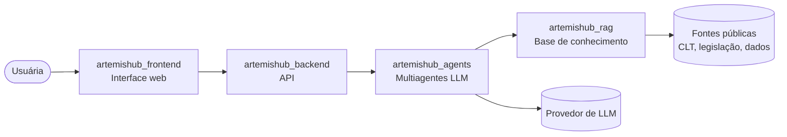

# 🌙 Artemis — Documentação

### Inteligência Artificial para impulsionar mulheres em STEM 💜

Este é o repositório central do **Artemis**. Aqui ficam a documentação do projeto, as decisões de arquitetura, os entregáveis de cada semana e o **kanban** (GitHub Project) onde organizamos as issues de todos os repositórios.

> 📋 **Kanban:** [Projects da ArtemisHubApp](https://github.com/orgs/ArtemisHubApp/projects)

## ✨ Sobre o projeto

O **Artemis** utiliza Inteligência Artificial para apoiar mulheres nas áreas de **Ciência, Tecnologia, Engenharia e Matemática (STEM)**, promovendo autonomia, valorização profissional e decisões de carreira mais seguras.

A plataforma pretende oferecer:

- 💼 **Análise de perfil e currículo:** identificação de competências e pontos fortes.
- 💰 **Inteligência salarial:** referências de remuneração e informações sobre desigualdade salarial.
- 🎯 **Oportunidades personalizadas:** recomendações alinhadas ao perfil e aos objetivos profissionais.
- 📈 **Desenvolvimento de carreira:** identificação de habilidades a aprimorar.
- 💬 **Simulação de negociação salarial:** prática de conversas profissionais com auxílio de IA.
- 📚 **Orientação confiável:** acesso a informações fundamentadas sobre direitos e carreira.

## 🏗️ Visão geral da arquitetura



## 🗂️ Repositórios do projeto

| Repositório | Responsabilidade |
|---|---|
| [artemishub_docs](https://github.com/ArtemisHubApp/artemishub_docs) | Documentação, decisões de arquitetura e kanban do projeto |
| [artemishub_frontend](https://github.com/ArtemisHubApp/artemishub_frontend) | Interface web da plataforma |
| [artemishub_backend](https://github.com/ArtemisHubApp/artemishub_backend) | API, regras de negócio, autenticação e persistência |
| [artemishub_agents](https://github.com/ArtemisHubApp/artemishub_agents) | Sistema multiagentes LLM, multimodalidade e modelos de ML |
| [artemishub_rag](https://github.com/ArtemisHubApp/artemishub_rag) | Base de conhecimento, indexação e recuperação com citações |

## 🗓️ Roadmap

| Semana | Foco | Entregável principal | Repositório |
|:---:|---|---|---|
| 1 | Problema, stakeholders, riscos e métricas | Definições do projeto | `artemishub_docs` |
| 2 | Base de conhecimento e recuperação | Primeiro mecanismo RAG | `artemishub_rag` |
| 3 | Comparação LLM x RAG | Respostas baseadas em evidências | `artemishub_rag` |
| 4 | Sistema multiagentes | Primeiro sistema multiagentes | `artemishub_agents` |
| 5 | Multimodalidade | Agentes multimodais | `artemishub_agents` |
| 6 | Integração completa | Aplicação funcional | `artemishub_backend` + `artemishub_frontend` |
| 7 | Testes e refinamento | Relatório final + apresentação | `artemishub_docs` |

## 📁 Estrutura da documentação

A documentação será organizada conforme os entregáveis forem produzidos:

```text
docs/
├── 01-definicoes/      # problema, stakeholders, riscos e métricas (semana 1)
├── arquitetura/        # visão geral, diagramas e integrações entre os repositórios
├── adr/                # registros de decisões de arquitetura (ADRs)
├── avaliacoes/         # comparação LLM x RAG e avaliação dos agentes
└── entrega-final/      # relatório final e apresentação (semana 7)
```

## 📋 Como trabalhamos (kanban)

Todas as issues — de qualquer repositório — entram no mesmo GitHub Project, com as colunas:

**Backlog → Todo → In Progress → In Review → Testing → Done**

1. Crie a issue no repositório correspondente (ou aqui, se for documentação ou tarefa geral).
2. Marque a **Semana** do roadmap a que ela pertence.
3. Ao começar, mova o card para **In Progress** e atribua a issue a você.
4. Abra o PR com `Closes #<número>` na descrição — o card vai para **In Review** automaticamente.
5. Com o PR aprovado o card vai para **Testing**; após o merge, para **Done**.

## 👩‍💻 Nossa equipe

Desenvolvido pelo **Grupo 11**, com atuação em Inteligência Artificial, Ciência de Dados, Engenharia de Dados, Arquitetura de Software e DevOps.

<table>
  <tr>
    <td align="center">
      <a href="https://github.com/CamilaSilvaC">
        <br/>
        <b>Camila</b>
      </a>
    </td>
    <td align="center">
      <a href="https://github.com/AmandaElisa">
        <br/>
        <b>Amanda</b>
      </a>
    </td>
    <td align="center">
      <a href="https://github.com/anajbsouza">
        <br/>
        <b>Ana Julia</b>
      </a>
    </td>
    <td align="center">
      <a href="https://github.com/eduardaoliveirazorg-jpg">
        <br/>
        <b>Eduarda</b>
      </a>
    </td>
  </tr>
</table>

---

<p align="center">
  <i>Artemis — Mais conhecimento, confiança e oportunidades para mulheres em STEM.</i> 💜
</p>
