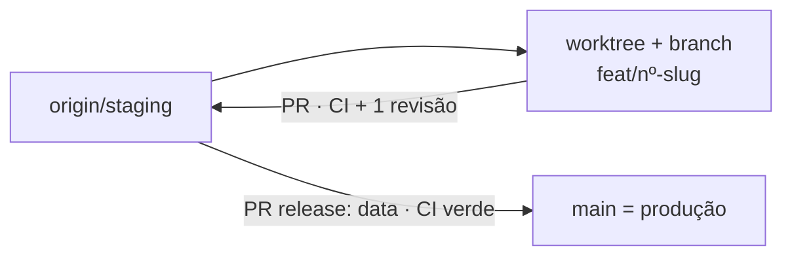

# ADR-008: fluxo staging → main com worktrees

- **Status:** proposto (aguardando aprovação do time)
- **Data:** 17/11/2026
- **Repo:** [artemishub_orchestration](https://github.com/ArtemisHubApp/artemishub_orchestration)

## Contexto

Até agora os PRs iam direto para a `main`, que também é a versão "de produção" (por exemplo, o site de docs publica a partir dela). Com quatro pessoas e vários agentes de IA trabalhando em paralelo, alguém mexendo direto no checkout principal atrapalha as outras e o próprio agente.

## Decisão

Todo trabalho nasce numa **worktree com branch própria, criada a partir de `origin/staging`**. O PR vai para `staging`, e a `main` só recebe o PR de release.

- **Worktree** é uma segunda pasta do mesmo repo, com outra branch. Cada pessoa ou agente trabalha isolado, sem mexer no checkout da `staging` que o compose e as outras usam. As worktrees ficam **fora** dos repos, em `../artemishub-worktrees/<repo>/<branch>/`, porque uma worktree dentro do submódulo vira milhares de arquivos "não rastreados".
- **Criar:** `python scripts/worktree.py new <repo> <tipo>/<nº da issue>-<slug>`. O script valida o nome e cria a branch sem rastrear a `staging`. O primeiro push é `git push -u origin <branch>`.
- **Limpar depois do merge:** `python scripts/worktree.py prune` mostra o que seria removido, e `prune --yes` remove. Ele só apaga worktrees limpas cuja branch comprovadamente entrou na base, e nunca uma recém-criada.
- **Nomes de branch:** `feat/`, `fix/`, `chore/`, `docs/`, `refactor/`, `test/` ou `ci/`, mais `<nº>-<slug>`. Por exemplo: `feat/20-ocr-diretrizes`.
- **`staging` é a branch padrão** de cada repo, porque o `Closes #` do GitHub só fecha a issue quando o merge é na branch padrão. A `main` continua sendo produção.
- **Release:** um PR `staging → main` com o título `release: <data>`, aberto quando a `staging` estiver estável, de preferência no fechamento de cada semana do roadmap. Ele usa merge commit, não squash, para as duas branches não divergirem.
- **Agente na worktree:** o agente é aberto na raiz do orquestrador, para ler as regras, e recebe acesso à pasta da worktree. Os comandos de cada ferramenta estão em "Como abrir o agente numa tarefa", no `AGENTS.md` do orquestrador.

## Alternativas

- **PR direto para a `main`:** é mais simples, mas qualquer merge vai direto para produção, incluindo o site.
- **Branches sem worktree, no checkout principal:** trocar de branch no meio de uma tarefa atrapalha quem compartilha a pasta e o compose.

## Consequências

- Alguém com acesso de admin precisa criar a `staging` em cada repo, torná-la padrão e proteger `staging` e `main` (PR obrigatório, CI verde e 1 aprovação).
- Até isso acontecer, os scripts usam a `main` como base e avisam: `AVISO: <repo> ainda não tem staging; usando main.`
- O `sync` nunca descarta mudança local. Se um repo estiver sujo, numa branch que não é a base, ou com commits só locais, ele pula esse repo e avisa.
