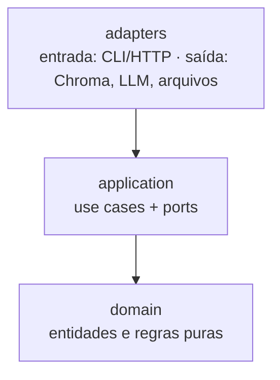

# ADR-010: código limpo e clean architecture (hexagonal)

- **Status:** proposto (aguardando aprovação do time)
- **Data:** 17/11/2026
- **Repo:** [artemishub_orchestration](https://github.com/ArtemisHubApp/artemishub_orchestration)

## Contexto

O `rag` já começou a migrar para camadas (`src/domain`, `src/application/{use_cases,ports}` e `src/adapters/outbound`), mas `pipeline_use_cases.py` importa `src.index` e `src.ingest` direto, sem passar pelas *ports*, o que já é uma violação da regra de dependência. Código escrito por agentes de IA tende a crescer rápido e a misturar responsabilidades se não houver regra e checagem automática.

## Decisão

**Uma fonte só para as regras:** `.agents/skills/artemis-sdd/references/codigo-limpo.md`, no orquestrador, linkado no `AGENTS.md`. Ela traz:

- **4 princípios para quem escreve código**, adaptados de *andrej-karpathy-skills* (MIT): pensar antes de codar, simplicidade primeiro, mudanças cirúrgicas e execução guiada por objetivo;
- **código limpo:**
    - nomes que dizem a intenção;
    - funções curtas, com uma responsabilidade;
    - nada de números ou textos "mágicos" no meio do código;
    - type hints em funções públicas;
    - erros explícitos;
    - nada de código morto;
    - comentário explica o *porquê*;
    - testes no formato *arrange, act, assert*;
- **clean architecture (hexagonal)** para `rag`, `agents` e `backend`:

As dependências só apontam para dentro. O domínio não importa nada de I/O. Os use cases só conhecem as *ports*. A montagem das peças acontece num único ponto de entrada.

**Migração gradual:** um módulo antigo só passa para as camadas quando uma tarefa já precisa mexer nele. Não haverá uma refatoração geral.

**Checagem no CI compartilhado (ADR-006):**

- **ruff** com regras ampliadas (bugs comuns, nomes, complexidade ≤ 10): bloqueia o merge;
- **import-linter** com contrato de camadas (`adapters → application → domain`) no `pyproject.toml` de cada repo: bloqueia o merge. A violação que já existe no `rag` entra numa lista de exceções, junto com a issue que vai removê-la, para não travar o CI no primeiro dia;
- **pyright** em modo básico: no início só avisa, e passa a bloquear quando o repo estiver limpo.

A revisão de PR, pelo checklist e pela etapa de revisão do Superpowers, usa o `codigo-limpo.md` como critério.

## Alternativas

- **Só recomendar, sem CI:** a regra se perde quando o prazo aperta.
- **Refatorar tudo de uma vez:** é arriscado no meio do roadmap e mistura mudança de estrutura com entrega.

## Consequências

- Os PRs de CI nos repos filhos incluem as regras ampliadas do ruff no `pyproject.toml` de cada repo (o CI compartilhado usa a configuração do próprio repo), o contrato de camadas e uma rodada de `ruff format`.
- O `frontend` ganha o equivalente (ESLint e fronteiras entre camadas) quando tiver stack.
