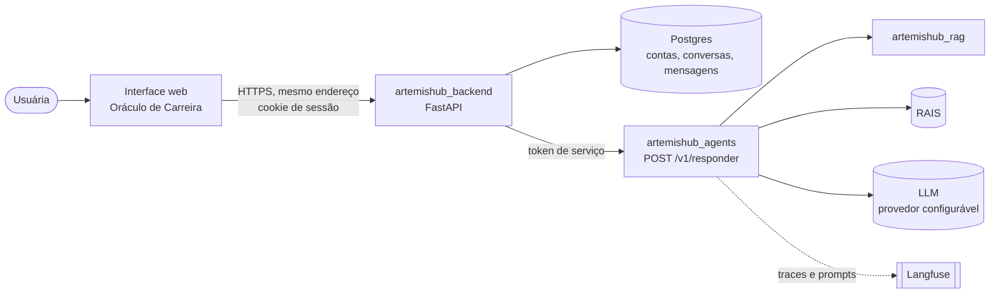
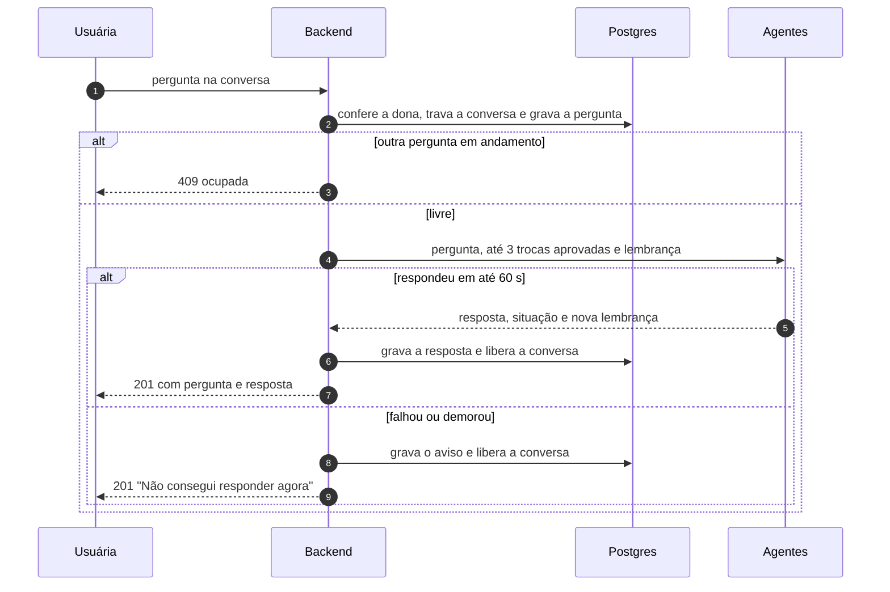

# Arquitetura do backend

!!! info "Estado em 26/11/2026"
    A API está pronta e testada, com agentes **simulados**. O endpoint dos agentes ainda não existe ([artemishub_agents#36](https://github.com/ArtemisHubApp/artemishub_agents/issues/36)), assim como o deploy ([artemishub_backend#6](https://github.com/ArtemisHubApp/artemishub_backend/issues/6)). A [interface web](frontend.md) está em construção. A stack está proposta no [ADR-001](../adr/001-stack.md).

O backend guarda as contas e o histórico de conversas da aba **Oráculo de Carreira**. Os agentes são um serviço separado e sem banco: recebem a pergunta e o contexto, e devolvem a resposta.

## Componentes

**Stack:** Python 3.12, FastAPI, SQLAlchemy 2 (async) com asyncpg, Alembic e Postgres 16. O código segue as camadas `domain`, `application` e `adapters`, com as dependências apontando para dentro.

## Como uma pergunta é respondida

O banco não fica preso enquanto os agentes respondem. Se a trava passar de 60 s e outra pergunta tomar o lugar, a resposta atrasada é descartada (409 `expirada`).

## Rotas

| Grupo | Rotas |
|---|---|
| Contas | `POST /v1/auth/cadastro`, `POST /v1/auth/login`, `POST /v1/auth/sair`, `GET`, `PATCH` e `DELETE /v1/conta`, `GET /v1/consentimento` |
| Conversas | `GET`, `POST` e `DELETE /v1/conversas` (lista paginada, criar, apagar todas), `GET` e `DELETE /v1/conversas/{id}` |
| Perguntas | `POST /v1/conversas/{id}/mensagens` |
| Saúde | `GET /health` |

A referência completa fica no README e no [OpenAPI](https://github.com/ArtemisHubApp/artemishub_backend/blob/main/contratos/openapi.json) do repositório.

## Dados

| Tabela | Guarda |
|---|---|
| `usuarias` | nome (primeiro nome ou apelido), e-mail, hash da senha (argon2) e data do consentimento |
| `conversas` | dona, título, lembrança (intenção, ocupação e UF) e a trava de pergunta em andamento |
| `mensagens` | texto, quem escreveu, ligação entre pergunta e resposta, e se a resposta foi aprovada ou bloqueada |

## Sessão e segurança

- **Sessão:** o login grava um cookie `HttpOnly`, `Secure` e `SameSite=Strict` de 60 minutos; o JavaScript da página não o lê. O token também volta no corpo, para testes e outros clientes.
- **Outros sites:** com o cookie, toda escrita exige que o pedido venha do próprio site (`Origin`); senão, 403. Frontend e API ficam no mesmo endereço, sem CORS.
- **Isolamento:** uma usuária nunca acessa a conversa de outra; a API responde 404, sem revelar que ela existe.
- **Logs:** sem texto das mensagens, nome, e-mail, senha ou token.
- **Pendente antes do deploy:** limite de tentativas de login ([artemishub_backend#17](https://github.com/ArtemisHubApp/artemishub_backend/issues/17)).

## Memória curta e proteções

- Só a mesma conversa e até 3 trocas, todas aprovadas pela Validação. Bloqueios, abstenções, perguntas fora de escopo e erros aparecem no histórico, mas não voltam ao LLM.
- Os agentes retiram limites, fontes e citações das respostas antigas e passam as perguntas de novo pelo guardrail (a fazer em [artemishub_agents#36](https://github.com/ArtemisHubApp/artemishub_agents/issues/36)).
- O histórico é dado, nunca instrução. Os números só podem vir da consulta atual.
- Nenhum e-mail nem id da usuária vai para os agentes; a lembrança não guarda sexo, raça nem salário.

## Privacidade

- O cadastro pede como a usuária quer ser chamada: primeiro nome ou apelido, de 1 a 40 caracteres, nunca o nome completo. Ela pode trocar em Minha conta.
- A Artemis vai chamar a usuária pelo nome. Ele ainda não é enviado aos agentes: isso entra com o contrato do [artemishub_agents#36](https://github.com/ArtemisHubApp/artemishub_agents/issues/36), e então passa também pelo provedor de LLM e pelo Langfuse. O texto do consentimento já avisa.
- Apagar uma conversa, todas ou a conta é definitivo no Postgres.
- O texto das perguntas vai para o provedor de LLM (hoje, o Gemini) e para o Langfuse, sem o e-mail. Os registros no Langfuse permanecem depois da exclusão.
- O texto do consentimento é provisório; o prazo de retenção e a justificativa dependem do ADR de LGPD.

## Como rodar

Veja o [README do backend](https://github.com/ArtemisHubApp/artemishub_backend#readme). Para desenvolver o frontend sem o serviço real, há agentes simulados (`python -m ferramentas.agentes_simulados`), que começam toda resposta com "[SIMULADO]". Os testes sobem um Postgres descartável e precisam do Docker.
