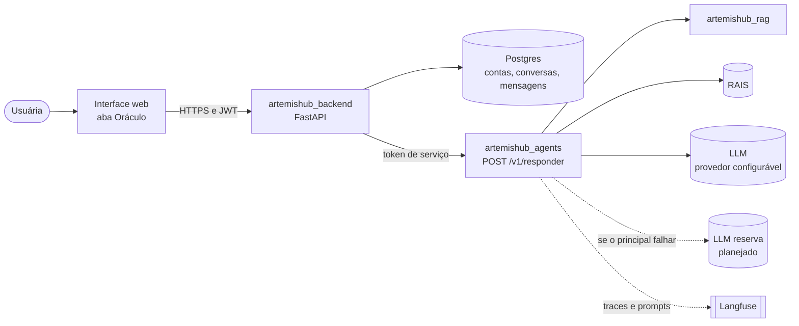
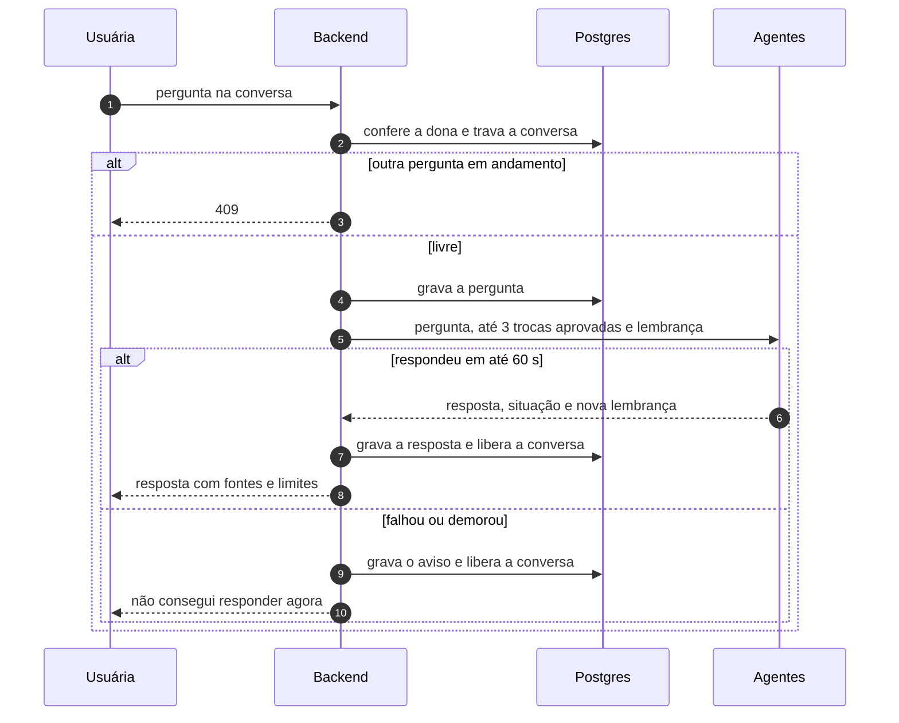

# Arquitetura do backend

!!! warning "Planejado"
    Proposta de 24/11/2026, ainda sem código. A stack (ADR-001) aguarda aprovação do time. Acompanhe na [artemishub_backend#13](https://github.com/ArtemisHubApp/artemishub_backend/issues/13).

O backend guarda as contas e o histórico de conversas da aba **Oráculo**. Os agentes são um serviço separado e sem banco: recebem a pergunta e o contexto, e devolvem a resposta.

## Componentes

## Como uma pergunta é respondida

O contrato do `/v1/responder` está em definição na [artemishub_agents#36](https://github.com/ArtemisHubApp/artemishub_agents/issues/36).

## Dados

| Tabela | Guarda |
|---|---|
| `usuarias` | e-mail, hash da senha e data do consentimento |
| `conversas` | dona, título e lembrança (intenção, ocupação e UF) |
| `mensagens` | texto, quem escreveu e se a resposta foi aprovada ou bloqueada |

## Memória curta e proteções

- Só a mesma conversa e até 3 trocas, todas aprovadas pela Validação. Bloqueios, abstenções, perguntas fora de escopo e erros aparecem no histórico, mas não voltam ao LLM.
- Os agentes retiram limites, fontes e citações das respostas antigas e passam as perguntas de novo pelo guardrail.
- O histórico é dado, nunca instrução. Os números só podem vir da consulta atual.
- A lembrança não guarda sexo, raça nem salário.

## Privacidade

- Uma usuária nunca acessa a conversa de outra; a API responde 404, sem revelar que ela existe.
- Apagar a conversa ou a conta é definitivo no Postgres.
- O texto das perguntas vai para o provedor de LLM configurado (hoje, o Gemini) e para o Langfuse, sem o e-mail. Cada provedor novo, inclusive o reserva, precisa constar no consentimento. Os registros no Langfuse permanecem depois da exclusão. O texto do consentimento, o prazo e a justificativa dependem do ADR de LGPD.
