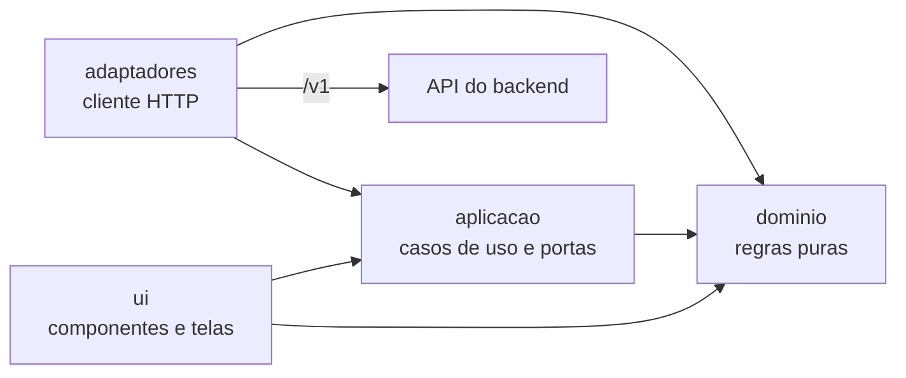

# Arquitetura do frontend

!!! info "Estado em 26/11/2026"
    A interface web já permite criar conta, entrar e ver a página inicial ([artemishub_frontend#6](https://github.com/ArtemisHubApp/artemishub_frontend/issues/6)). A conversa no Oráculo de Carreira e a tela Minha conta, com o botão de sair, ainda não estão prontas. Não há deploy ([artemishub_backend#6](https://github.com/ArtemisHubApp/artemishub_backend/issues/6)).

A interface fala só com a API do [backend](backend.md). Nunca chama os agentes nem o LLM direto.

## Telas

| Tela | O que faz | Estado |
|---|---|---|
| Entrar e Criar conta | e-mail, senha, como a usuária quer ser chamada e aceite do Aviso de Privacidade | pronta |
| Aviso de Privacidade | pública, com o texto que vem da API | pronta |
| Início (aba Meus Alvos) | saudação com o nome e atalho para o Oráculo | pronta |
| Oráculo de Carreira | conversa com a Artemis e histórico | em construção |
| Minha conta | nome, sair, apagar conversas e conta | em construção |
| Rede, Academia, Mercado | abas visíveis, marcadas como "em breve" | futuras |

## Camadas

O lint reprova import na direção errada. Só o ponto de entrada (`main.tsx`) liga as camadas. Os tipos da API são gerados do OpenAPI do backend, e o CI falha se estiverem desatualizados em relação à cópia guardada no repositório.

**Stack:** React 19, Vite, TypeScript, Tailwind 4 e React Router. Testes com Vitest, Testing Library e axe.

## Design system

Cores iguais às deste site, fontes DM Sans e DM Serif Display servidas pela própria aplicação, componentes com seus estados e um catálogo disponível só no desenvolvimento. A navegação fica embaixo até 1023 px de largura e vira menu lateral a partir de 1024 px.

## Sessão e privacidade

- A sessão fica num cookie `HttpOnly` gravado pela API: a página não lê nem guarda o token.
- Frontend e API ficam no mesmo endereço, sem CORS. No desenvolvimento, o Vite repassa `/v1` para a API.
- O cadastro pede só o primeiro nome ou apelido. Veja [Privacidade no backend](backend.md#privacidade).

## Como rodar

Veja o [README do frontend](https://github.com/ArtemisHubApp/artemishub_frontend#readme).
