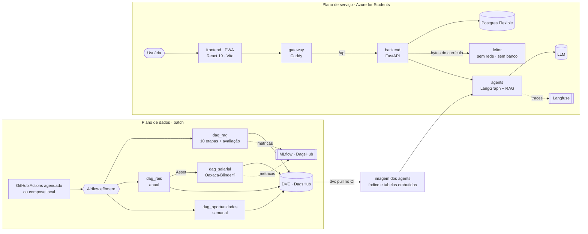

# Implantação e pipelines de dados

!!! warning "Proposta em revisão"
    Esta página descreve o desenho do [ADR-012](../adr/012-implantacao-e-pipelines-de-dados.md), que ainda está **proposto**. Nada aqui está implantado ainda.

O sistema tem dois planos:

- **Plano de serviço:** responde à usuária e roda o tempo todo no Azure for Students.
- **Plano de dados:** atualiza as bases do RAG e da RAIS de vez em quando, com Airflow efêmero. Os resultados são publicados como artefatos versionados.

Os dois planos se encontram na imagem dos `agents`, que já sai do CI com o índice e as tabelas dentro.

## Plano de serviço

| Componente | Serviço no Azure | Papel |
|---|---|---|
| `frontend` | build estático no `gateway` | PWA: cadastro com consentimento, login, conversas e Minha conta. O cliente da API é gerado do `contratos/openapi.json`. |
| `gateway` | Container Apps | entrega o build do frontend e faz proxy de `/api`, mantendo a mesma origem que o cookie `SameSite=Strict` exige |
| `backend` | Container Apps (ingress interno) | camadas hexagonais; cadastro, sessão em cookie, conta e conversas em `/v1` ([Arquitetura do backend](backend.md)) |
| `agents` | Container Apps (ingress interno) | multiagentes com o RAG embutido, somente leitura |
| `leitor` | Container Apps (ingress interno, scale-to-zero) | lê o currículo em PDF ou foto na CPU, com modelo aberto; **sem saída para a internet e sem banco** |
| Postgres | Flexible Server B1ms | dados pessoais ficam só aqui, inclusive o **texto** do currículo, conferido e mascarado |

O PWA usa `vite-plugin-pwa`. O service worker guarda só o shell e os assets, nunca respostas da API.

O currículo enviado (PDF ou foto) **nunca é gravado**: passa só pela memória do backend e do leitor, e só o texto que a usuária confere fica no Postgres. Por isso a arquitetura não tem Blob Storage. Detalhes no [desenho do currículo](https://github.com/ArtemisHubApp/artemishub_backend/blob/claude/pensive-franklin-ggl64a/docs/superpowers/specs/2026-11-26-curriculo-design.md).

## Stack

| Parte | Tecnologias | Situação |
|---|---|---|
| Frontend | React 19, Vite, TypeScript, Tailwind 4, `vite-plugin-pwa` (Workbox); Vitest, Testing Library, axe, Playwright | em construção ([frontend#2](https://github.com/ArtemisHubApp/artemishub_frontend/issues/2)) |
| Backend | Python 3.12, FastAPI, SQLAlchemy 2 async, asyncpg, Alembic, Postgres 16; pytest e testcontainers | em uso |
| Agentes | Python 3.12, LangGraph, `langchain-openai` (Gemini Flash), Langfuse, pandas, pyarrow | em uso |
| RAG | Python 3.11 a 3.13, ChromaDB, sentence-transformers (MiniLM multilíngue), BM25 + RRF, PyMuPDF, BeautifulSoup, httpx | em uso |
| Leitor de currículo | PyMuPDF e um modelo aberto de leitura de imagem na CPU (candidatos: RapidOCR, docTR, Florence-2; escolha da Ana Julia) | planejado ([agents#14](https://github.com/ArtemisHubApp/artemishub_agents/issues/14)) |
| Dados e MLOps | DVC e DagsHub (em uso); Airflow 3, MLflow e o modelo salarial (planejados) | parcial |
| Infra e entrega | uv, Docker, docker compose, GitHub Actions (em uso); Caddy, Azure Container Apps, Postgres Flexible, GHCR ou ACR, Azure Budgets (planejados) | parcial |
| Docs e processo | MkDocs Material, GitHub Pages, ADRs, `AGENTS.md`, Superpowers (SDD), GitHub Projects | em uso |

## Plano de dados

| DAG | Quando roda | O que faz | Publica |
|---|---|---|---|
| `dag_rag` | mensal ou sob demanda | coleta, valida, faz o chunking, gera os embeddings e avalia o recall@k | índice do ChromaDB |
| `dag_rais` | anual (RAIS nova) | baixa, filtra STEM, agrega com pelo menos 30 vínculos por recorte | parquet e agregados |
| `dag_salarial` | quando a `dag_rais` publica | modelo salarial (por exemplo, decomposição de Oaxaca-Blinder por recorte) | tabelas agregadas |
| `dag_oportunidades` | semanal, se o RF-10 virar coleta | catálogo de cursos e bolsas, com a data de atualização | catálogo |

Cada DAG só chama funções dos pacotes dos repositórios, que continuam testáveis sem Airflow. Uma DAG só publica se todas as etapas passarem, a mesma regra da [publicação atômica](../rag/pipeline.md).

## Rastreamento

| Ferramenta | Para quê |
|---|---|
| **Langfuse** | LLM em execução: traces, prompts e avaliação das respostas |
| **MLflow** (no DagsHub) | experimentos offline: modelo salarial e ajuste do RAG |
| **DVC + DagsHub** | versões dos dados e dos índices |

## Custo estimado

| Item | US$/mês |
|---|---|
| Container Apps (dentro da cota gratuita, inclusive o `leitor` com scale-to-zero; com 1 réplica mínima nos `agents`, de 10 a 25) | 0 a 25 |
| Postgres B1ms (gratuito por 12 meses na assinatura de estudante) | 0 |
| Registro de imagens (ACR Basic; GHCR é gratuito) | 0 a 5 |
| Airflow no GitHub Actions, DagsHub, MLflow | 0 |
| LLM (Gemini Flash, cerca de 1.000 perguntas) | 3 a 6 |
| **Total** | **cerca de 5 a 30** |

Valores estimados com preços de tabela, ainda sem conferência na calculadora do Azure. As alternativas avaliadas e os riscos estão no [ADR-012](../adr/012-implantacao-e-pipelines-de-dados.md).
