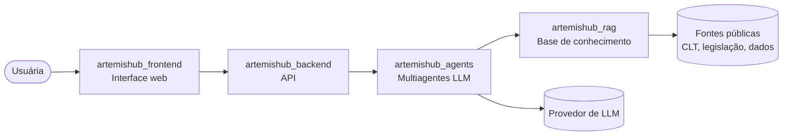

# Arquitetura

O Artemis é dividido em **cinco repositórios**, cada um com uma responsabilidade clara.



## Repositórios do projeto

| Repositório | Responsabilidade |
|---|---|
| [artemishub_docs](https://github.com/ArtemisHubApp/artemishub_docs) | Documentação, decisões de arquitetura e kanban do projeto |
| [artemishub_frontend](https://github.com/ArtemisHubApp/artemishub_frontend) | Interface web da plataforma |
| [artemishub_backend](https://github.com/ArtemisHubApp/artemishub_backend) | API, regras de negócio, autenticação e persistência |
| [artemishub_agents](https://github.com/ArtemisHubApp/artemishub_agents) | Sistema multiagentes LLM, multimodalidade e modelos de ML |
| [artemishub_rag](https://github.com/ArtemisHubApp/artemishub_rag) | Base de conhecimento, indexação e recuperação com citações |

## Princípios do frontend

- **Acessibilidade:** seguir as diretrizes WCAG 2.1 AA.
- **Transparência:** toda resposta gerada por IA deve mostrar as fontes utilizadas.
- **Linguagem acolhedora:** textos claros, inclusivos e sem jargão desnecessário.
- **Responsividade:** funcionar bem em celular e desktop.

!!! note "Sobre a versão de WCAG"
    O README do frontend cita **WCAG 2.1 AA**, enquanto o [PDR](../produto/requisitos.md) (RNF-04) especifica **WCAG 2.2** níveis A e AA. As duas informações foram mantidas como estão nos documentos de origem.

## Decisões de arquitetura (ADRs)

As decisões serão registradas como ADR neste repositório, conforme forem tomadas. A stack do frontend está "a definir pela equipe".

## Próximos documentos previstos

```text
docs/
├── 01-definicoes/      # produto e requisitos
├── arquitetura/        # visão geral, diagramas e integrações entre os repositórios
├── adr/                # registros de decisões de arquitetura (ADRs)
├── avaliacoes/         # comparação LLM x RAG e avaliação dos agentes
└── relatorios/      # relatórios e apresentações
```
