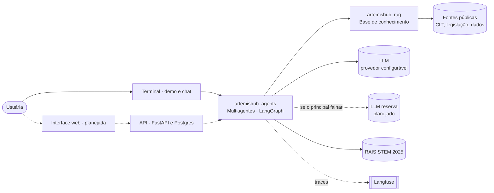

# Arquitetura

O [protótipo multiagente](multiagentes.md) roda no terminal com LangGraph. O Orquestrador encaminha a pergunta para Pesquisa e/ou Análise. A Pesquisa recupera trechos de fontes públicas, a Análise reúne os dados da RAIS e as evidências em um rascunho, e a Validação verifica citações e valores antes de o Orquestrador formatar a resposta.

Também é possível executar separadamente a [consulta ao RAG](../rag/consulta.md) e a [consulta salarial da RAIS](consulta-salarial.md). Para rodar a demonstração ou conversar com o protótipo, siga o [guia de reprodução](../guias/reproduzir.md#prototipo-multiagente).

O diagrama mostra o protótipo, a [API](backend.md), já pronta, e a interface web, em construção.



## Repositórios do projeto

| Repositório | Responsabilidade |
|---|---|
| [artemishub_docs](https://github.com/ArtemisHubApp/artemishub_docs) | Documentação, decisões de arquitetura e kanban do projeto |
| [artemishub_frontend](https://github.com/ArtemisHubApp/artemishub_frontend) | Interface web da plataforma |
| [artemishub_backend](https://github.com/ArtemisHubApp/artemishub_backend) | API, regras de negócio, autenticação e persistência |
| [artemishub_agents](https://github.com/ArtemisHubApp/artemishub_agents) | Sistema multiagentes LLM, multimodalidade e modelos de ML |
| [artemishub_rag](https://github.com/ArtemisHubApp/artemishub_rag) | Base de conhecimento, indexação e recuperação com citações |
| [artemishub_orchestration](https://github.com/ArtemisHubApp/artemishub_orchestration) | Repo guarda-chuva: reúne os cinco como submódulos, guarda as regras para agentes de IA (`AGENTS.md`), as skills de SDD, os scripts e o CI compartilhado ([ADR-003](../adr/003-repo-orquestrador.md)) |

## Princípios do frontend

- **Acessibilidade:** seguir as diretrizes WCAG 2.1 AA.
- **Transparência:** toda resposta gerada por IA deve mostrar as fontes utilizadas.
- **Linguagem acolhedora:** textos claros, inclusivos e sem jargão desnecessário.
- **Responsividade:** funcionar bem em celular e desktop.

!!! note "Sobre a versão de WCAG"
    O README do frontend cita **WCAG 2.1 AA**, enquanto o [PDR](../produto/requisitos.md) (RNF-04) especifica **WCAG 2.2** níveis A e AA. As duas informações foram mantidas como estão nos documentos de origem.

## Decisões de arquitetura (ADRs)

A arquitetura completa, com contexto, containers, componentes, implantação e a sequência de uma pergunta, está em [Visões C4](visoes-c4.md). As decisões ficam em [Decisões (ADRs)](../adr/index.md). A proposta de implantação e de atualização das bases (Azure for Students, Airflow efêmero e DVC no DagsHub) está em [Implantação e pipelines de dados](implantacao.md) ([ADR-012](../adr/012-implantacao-e-pipelines-de-dados.md), proposto). O sistema multiagente usa LangGraph e Langfuse ([ADR-002](../adr/002-framework-multiagente.md)); o desenho completo está em [Arquitetura multiagente](multiagentes.md). A stack do frontend continua "a definir pela equipe" (ADR-001).

## Próximos documentos previstos

```text
docs/
├── 01-definicoes/      # produto e requisitos
├── arquitetura/        # visão geral, diagramas e integrações entre os repositórios
├── adr/                # registros de decisões de arquitetura (ADRs)
├── avaliacoes/         # comparação LLM x RAG e avaliação dos agentes
└── relatorios/      # relatórios e apresentações
```
