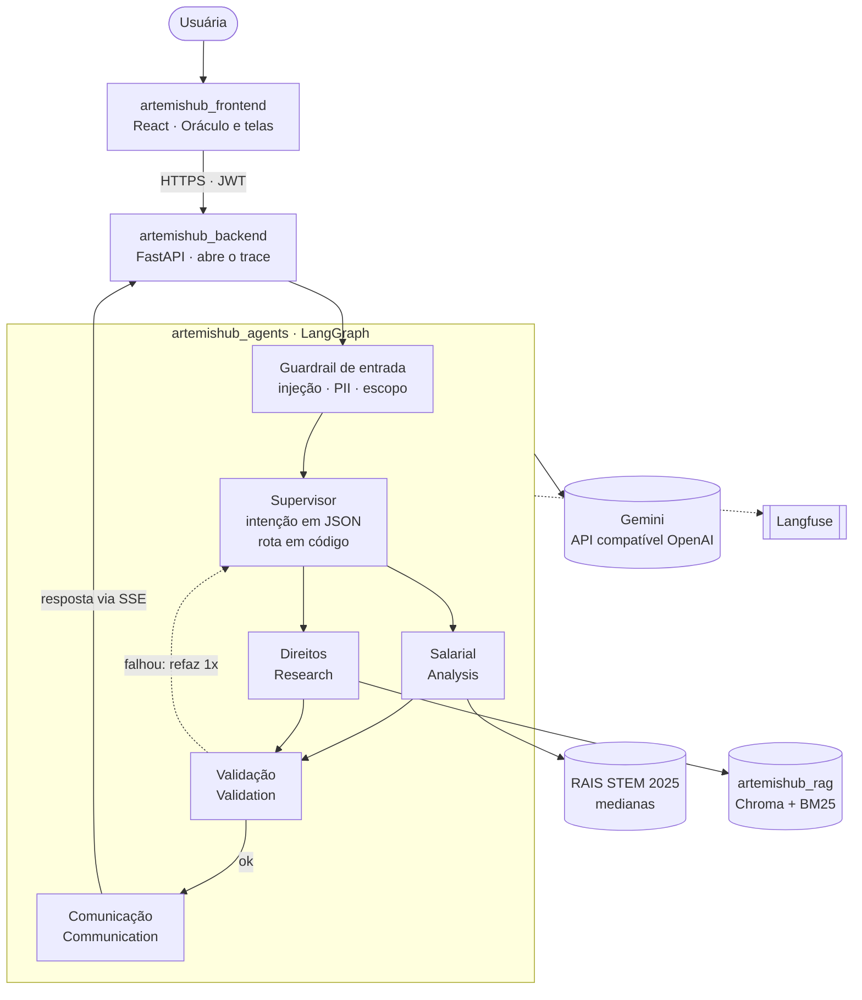
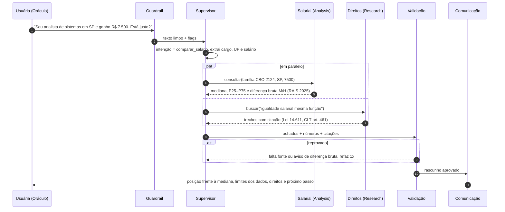

# Arquitetura multiagente

Os agentes ficam no `artemishub_agents`, orquestrados com **LangGraph** (ver [ADR-002](../adr/002-framework-multiagente.md)). Eles usam o `artemishub_rag` e a base da RAIS como ferramentas e enviam traces ao **Langfuse**.

A usuária fala com o Oráculo ou usa as telas. A API abre um trace no Langfuse e chama o grafo. O grafo filtra a entrada, roteia para um ou mais agentes especialistas, passa tudo pela validação e só então responde.

!!! info "O que entra na demonstração de 20/11"
    Guardrail, Supervisor, **Salarial** (Analysis), **Direitos** (Research), **Validação** (Validation) e **Comunicação** (Communication). Perfil, Oportunidades, Plano e Negociação entram nas próximas semanas.

## Diagrama da arquitetura



Todos os nós do grafo acima entram na demonstração de 20/11. Nas próximas semanas, o Supervisor passa a despachar também para **Perfil**, **Oportunidades**, **Plano** e **Negociação** (subgrafo multi-turno), que usam o parser de CV, o catálogo de oportunidades e o Postgres (perfil, plano e checkpoints do grafo). Salarial e Direitos rodam em paralelo com `Send()`.

## Responsabilidades dos agentes

| Agente | Requisitos | Tela | Ferramentas | Usa LLM para |
|---|---|---|---|---|
| **Guardrail** · 20/11 | RNF-07, RNF-16, métrica de segurança | todas | regras + classificador pequeno | classificar injeção e escopo |
| **Supervisor / Oráculo** · 20/11 | RNF-15 | Oráculo | nenhuma | extrair a intenção em JSON; a rota é um `if` |
| Perfil | RF-02 a RF-05 | Dashboard | parser de CV, perfil | extrair competências com trecho de evidência |
| **Salarial** (Analysis Agent) · 20/11 | RF-06 a RF-08 | Salário | `src.salarios.consultar` (medianas da RAIS 2025); modelo salarial depois | explicar a faixa; nunca calcular números |
| **Direitos** (Research Agent) · 20/11 | RNF-12, RNF-13 | Oráculo | RAG atual (`Retriever`) | responder com citações validadas |
| Oportunidades | RF-10 a RF-13 | Network, Guild | catálogo e filtros | justificar a compatibilidade |
| Plano de carreira | RF-14 a RF-17 | Dashboard | perfil, catálogo, plano | propor ações a partir das lacunas |
| Negociação | RF-09 | Salário | faixa do agente Salarial | fazer o papel do recrutador e dar feedback |
| **Validação** (Validation Agent) · 20/11 | RNF-12 a RNF-15 | todas | validação de citações e juiz do `artemishub_rag` | checar se a resposta segue as evidências; reprovar e devolver 1x |
| **Comunicação** (Communication Agent) · 20/11 | RNF-13, métrica 10.5 | todas | nenhuma | reescrever em linguagem simples sem perder citações |

## Fluxo da demonstração: "Estou ganhando o justo?"

Os quatro papéis do enunciado (Research, Analysis, Validation e Communication) colaboram numa pergunta. Nesta versão o cargo, a UF e o salário vêm da própria pergunta; o agente Perfil entra depois.



### Como os agentes colaboram

1. **Guardrail** limpa o texto, marca PII e recusa pedidos fora de escopo ou com tentativa de injeção.
2. **Supervisor** devolve só um JSON de intenção, validado por schema. Uma função Python escolhe os agentes.
3. **Salarial** e **Direitos** rodam em paralelo (`Send()`). Cada um escreve só no seu campo do estado: números com fonte, e trechos com citação.
4. **Validação** confere se toda afirmação tem fonte e se as limitações aparecem (emprego formal, diferença bruta). Se reprovar, devolve uma vez; na segunda falha, o sistema se abstém.
5. **Comunicação** separa fato verificado de sugestão, usa linguagem simples e lista as fontes no fim.

## Segurança: nenhum agente obedece texto externo

<div class="grid cards" markdown>

-   **Roteamento em código**

    O LLM do supervisor só devolve um JSON de intenção validado por schema. Quem escolhe o próximo nó é uma função Python.

-   **Conteúdo como dado**

    CV, documentos do RAG e mensagens vão em campos delimitados e marcados como não confiáveis, como o prompt atual do RAG já faz.

-   **Agentes não conversam entre si**

    Cada agente escreve só no seu campo do estado. Nenhum agente recebe a saída livre de outro como instrução.

-   **Tools sem efeito colateral**

    No MVP as ferramentas só leem. Salvar oportunidade ou atualizar plano passa pela API com confirmação da usuária.

</div>

## Observabilidade com Langfuse

| Recurso | Uso no Artemis |
|---|---|
| Traces | 1 trace por pergunta, 1 span por nó, tool e chamada de LLM |
| Sessões | `session = thread_id`, `user = id pseudonimizado` |
| Prompts versionados | um prompt por agente, rótulo `production` |
| Scores | faithfulness (LLM juiz), citação válida (regra), feedback da usuária |
| Datasets | `evaluation/*.jsonl` + cenários de injeção, rodados no CI |
| Latência e custo | alerta se p95 > 10 s (meta do PDR 10.3) |
| Equidade | scores por recorte agregado (RNF-14) |
| Privacidade | `mask()` remove PII antes de enviar (RNF-16) |

```python
from langfuse import get_client
from langfuse.langchain import CallbackHandler
from langgraph.graph import StateGraph, START, END

graph = StateGraph(ArtemisState)
graph.add_node("guardrail", guardrail_node)
graph.add_node("supervisor", supervisor_node)
graph.add_node("salarial", salary_agent)      # chama a consulta salarial via porta
graph.add_node("direitos", rights_agent)      # chama artemis_rag.buscar (API pública do RAG)
graph.add_node("validacao", validation_node)
graph.add_node("comunicacao", communication_node)
graph.add_edge(START, "guardrail")
graph.add_conditional_edges("guardrail", block_or_continue)
graph.add_conditional_edges("supervisor", route_by_intent)  # Send() para cada agente
app = graph.compile(checkpointer=postgres_saver)

langfuse = get_client()   # LANGFUSE_PUBLIC_KEY / SECRET_KEY / HOST no .env
handler = CallbackHandler()

result = app.invoke(
    {"message": texto},
    config={
        "callbacks": [handler],
        "configurable": {"thread_id": conversa_id},
        "metadata": {"langfuse_session_id": conversa_id,
                     "langfuse_user_id": user_hash,
                     "langfuse_tags": ["oraculo", "mvp"]},
    },
)
```

O nó de Direitos reaproveita o `Retriever` e a validação de citações de `src/query.py` sem mudar o RAG.

## Ordem de implementação

1. **Até 20/11:** ADR do framework (este repositório), remote do DVC configurado e tabela de medianas por família CBO × UF × sexo versionada no git.
2. **Até 20/11:** pacote do RAG renomeado para poder ser importado pelo `artemishub_agents` (os dois repositórios usam `src`).
3. **Até 20/11:** grafo da demo (Guardrail, Supervisor, Salarial, Direitos, Validação e Comunicação) com testes por nó e `reports/demo_multiagente.md` para o Teams.
4. Langfuse instrumentando o grafo; datasets de avaliação e de injeção no CI.
5. [Modelo salarial](modelo-salarial.md) no lugar das medianas; agente Perfil; subgrafo de Negociação; Oportunidades e Plano.
