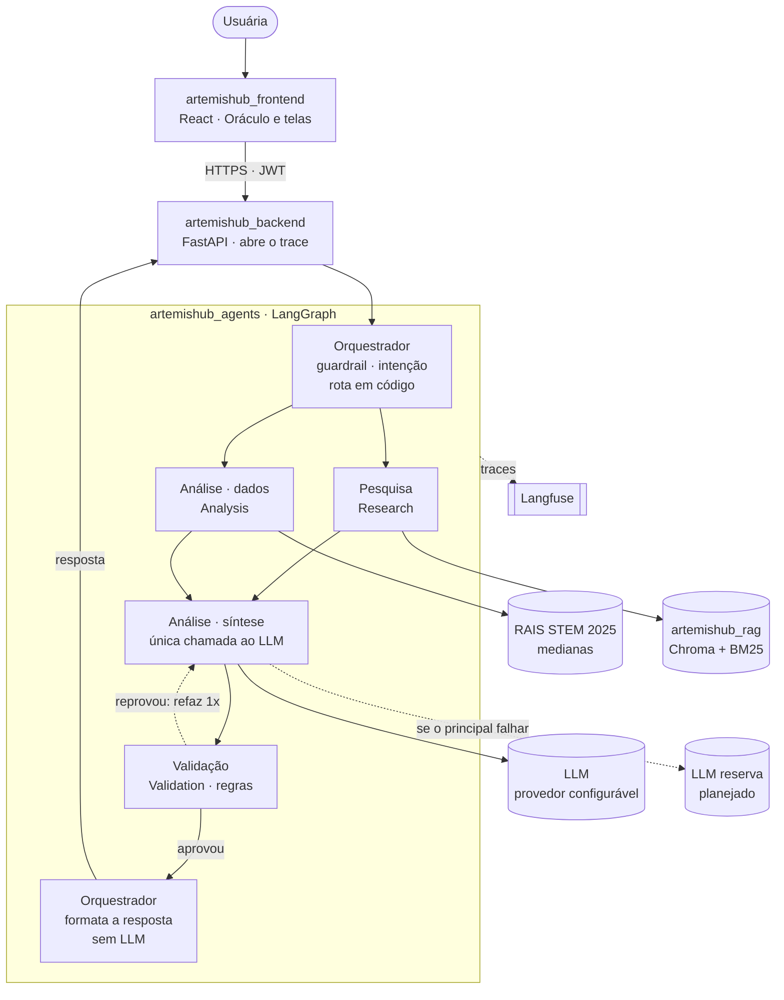
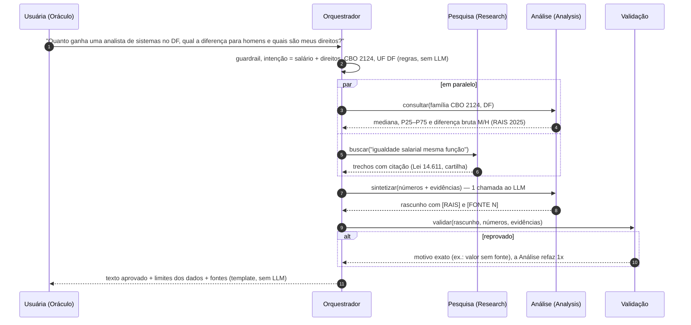

# Arquitetura multiagente

Os agentes ficam no `artemishub_agents`, orquestrados com **LangGraph** (ver [ADR-002](../adr/002-framework-multiagente.md)). Eles usam o `artemishub_rag` e a base da RAIS como ferramentas e enviam traces ao **Langfuse**.

A usuária fala com o Oráculo ou usa as telas. A API abre um trace no Langfuse e chama o grafo. O grafo filtra a entrada, roteia para um ou mais agentes especialistas, passa tudo pela validação e só então responde.

!!! info "O que entra na demonstração de 20/11"
    **Orquestrador** (guardrail, intenção e resposta final), **Pesquisa** (Research), **Análise** (Analysis) e **Validação** (Validation). O agente de Comunicação saiu do desenho em 19/11: o Orquestrador formata a resposta, sem mais uma chamada ao LLM ([ADR-011](../adr/011-orquestrador-formata-resposta.md)). Perfil, Oportunidades, Plano e Negociação entram nas próximas semanas.

## Diagrama da arquitetura

O provedor de LLM é escolhido no `.env` (`LLM_BASE_URL`, `LLM_MODEL`, `LLM_API_KEY`), entre as APIs compatíveis com a da OpenAI; até agora só o Gemini foi testado. O LLM reserva ainda não existe: hoje, se o LLM falha, a Análise usa um rascunho padrão, sem LLM ([artemishub_agents#60](https://github.com/ArtemisHubApp/artemishub_agents/issues/60)).

Todos os nós do grafo acima entram na demonstração de 20/11; o frontend e o backend ainda não (a demo roda pela linha de comando). Nas próximas semanas, o Orquestrador passa a despachar também para **Perfil**, **Oportunidades**, **Plano** e **Negociação** (subgrafo multi-turno), que usam o parser de CV, o catálogo de oportunidades e o Postgres (perfil, plano e checkpoints do grafo). Pesquisa e Análise (dados) rodam em paralelo no mesmo passo do grafo.

## Responsabilidades dos agentes

| Agente | Requisitos | Tela | Ferramentas | Usa LLM para |
|---|---|---|---|---|
| **Orquestrador / Oráculo** · 20/11 | RNF-07, RNF-15, RNF-16, métrica de segurança | todas | regras de guardrail e de intenção, `buscar_ocupacao` | nada: guardrail, intenção, rota e formatação da resposta final são código |
| Perfil | RF-02 a RF-05 | Dashboard | parser de CV, perfil | extrair competências com trecho de evidência |
| **Análise** (Analysis Agent) · 20/11 | RF-06 a RF-08 | Salário | `src.salarios.consultar` (medianas da RAIS 2025); modelo salarial depois | escrever o rascunho em linguagem simples com os números prontos; nunca calcular |
| **Pesquisa** (Research Agent) · 20/11 | RNF-12, RNF-13 | Oráculo | RAG atual (`Retriever`) | nada: devolve trechos com citação |
| Oportunidades | RF-10 a RF-13 | Network, Guild | catálogo e filtros | justificar a compatibilidade |
| Plano de carreira | RF-14 a RF-17 | Dashboard | perfil, catálogo, plano | propor ações a partir das lacunas |
| Negociação | RF-09 | Salário | faixa do agente de Análise | fazer o papel do recrutador e dar feedback |
| **Validação** (Validation Agent) · 20/11 | RNF-12 a RNF-15 | todas | regras: citação existe, todo parágrafo citado, todo valor veio da RAIS ou da evidência, aviso de diferença bruta | nada; reprova com o motivo exato e devolve 1x (o juiz por LLM entra depois) |

## Fluxo da demonstração: "Quanto ganha e quais são meus direitos?"

Pesquisa, Análise e Validação colaboram numa pergunta, e o Orquestrador entrega a resposta. Nesta versão o cargo, a UF e o salário vêm da própria pergunta; o agente Perfil entra depois.

### Como os agentes colaboram

1. **Orquestrador** recusa pergunta vazia, longa demais, fora de escopo ou com tentativa de injeção, e lê a intenção, a ocupação, a UF e o salário com regras (sem LLM). Uma função Python escolhe os agentes.
2. **Pesquisa** e **Análise (dados)** rodam em paralelo. Cada uma escreve só no seu campo do estado: trechos com citação, e números com fonte.
3. **Análise (síntese)** escreve o rascunho com os números já formatados, em linguagem simples. É a única chamada ao LLM; sem LLM configurado, usa um rascunho padrão.
4. **Validação** confere se toda citação existe, se todo parágrafo tem fonte, se todo valor veio da RAIS ou da evidência e se o aviso de diferença bruta aparece. Se reprovar, a Análise refaz uma vez; na segunda falha, o sistema se abstém.
5. **Orquestrador** entrega o texto aprovado sem alteração, com os limites dos dados e as fontes citadas ([ADR-011](../adr/011-orquestrador-formata-resposta.md)).

## Segurança: nenhum agente obedece texto externo

-   **Roteamento em código**

    A intenção é lida por regras e quem escolhe o próximo nó é uma função Python. O LLM só escreve o rascunho, e a Validação confere tudo.

-   **Conteúdo como dado**

    CV, documentos do RAG e mensagens vão em campos delimitados e marcados como não confiáveis, como o prompt atual do RAG já faz.

-   **Agentes não conversam entre si**

    Cada agente escreve só no seu campo do estado. Nenhum agente recebe a saída livre de outro como instrução.

-   **Tools sem efeito colateral**

    No MVP as ferramentas só leem. Salvar oportunidade ou atualizar plano passa pela API com confirmação da usuária.

## Observabilidade com Langfuse

| Recurso | Uso no Artemis |
|---|---|
| Traces | 1 trace por pergunta, 1 span por nó, tool e chamada de LLM |
| Sessões | `session = thread_id`, `user = id pseudonimizado` |
| Prompts versionados | um prompt por agente, rótulo `production` |
| Scores | faithfulness (LLM juiz), citação válida (regra), feedback da usuária |
| Datasets | `evaluation/*.jsonl` + cenários de injeção, rodados no CI |
| Latência e custo | alerta se p95 > 10 s (meta do PDR 10.3) |
| Equidade | scores por recorte agregado (RNF-14) |
| Privacidade | `mask()` remove PII antes de enviar (RNF-16) |

**Implementado no protótipo (19/11):** um trace `responder-pergunta` por pergunta. A raiz é um `agent`, com a pergunta como entrada e a resposta como saída. Os nós do LangGraph entram pelo `CallbackHandler`, e as etapas têm o tipo certo:

| Observação | Tipo | O que mostra |
|---|---|---|
| `orquestrador`, `pesquisa`, `analise_dados`, `analise_sintese`, `validacao`, `resposta` | chain | estado que entrou e saiu de cada nó |
| `verificar-entrada` | guardrail | se a pergunta foi bloqueada |
| `buscar-direitos` | retriever | tema, top_k e trechos com citação |
| `consultar-rais` | tool | família da CBO, UF e números da RAIS |
| `redigir-rascunho` | generation | prompt, resposta, modelo e tokens |
| `validar-rascunho` | evaluator | veredito e motivo exato da reprovação |

Também já entraram (19/11): sessão por conversa no chat do terminal, o prompt da Análise versionado só no Langfuse (`artemis/analise-resposta`), environment e release, scores por trace (`validacao_aprovada`, `tentativas`, `abstencao`, `bloqueada`, `fora_de_escopo`) e memória da conversa só com intenção, ocupação e UF ([artemishub_agents#41](https://github.com/ArtemisHubApp/artemishub_agents/pull/41), [#46](https://github.com/ArtemisHubApp/artemishub_agents/pull/46), [#47](https://github.com/ArtemisHubApp/artemishub_agents/pull/47), [#49](https://github.com/ArtemisHubApp/artemishub_agents/pull/49)). Datasets e o `mask()` de PII entram nas próximas semanas. A Pesquisa usa o pacote `artemis_rag` no mesmo processo dos agentes ([artemishub_agents#55](https://github.com/ArtemisHubApp/artemishub_agents/pull/55)).

## Ordem de implementação

1. **Até 20/11:** ADR do framework (este repositório), remote do DVC configurado e tabela de medianas por família CBO × UF × sexo versionada no git.
2. **Feito em 19/11:** pacote do RAG renomeado para `artemis_rag`, importável pelo `artemishub_agents` ([artemishub_rag#27](https://github.com/ArtemisHubApp/artemishub_rag/pull/27)).
3. **Feito em 19/11:** grafo da demo (Orquestrador, Pesquisa, Análise e Validação) com testes por nó e de ponta a ponta, executor `uv run python -m src.agentes.demo` e Langfuse instrumentando o grafo ([artemishub_agents#27](https://github.com/ArtemisHubApp/artemishub_agents/issues/27)).
4. Datasets de avaliação e de injeção no CI; juiz por LLM na Validação.
5. [Modelo salarial](modelo-salarial.md) no lugar das medianas; agente Perfil; subgrafo de Negociação; Oportunidades e Plano.
