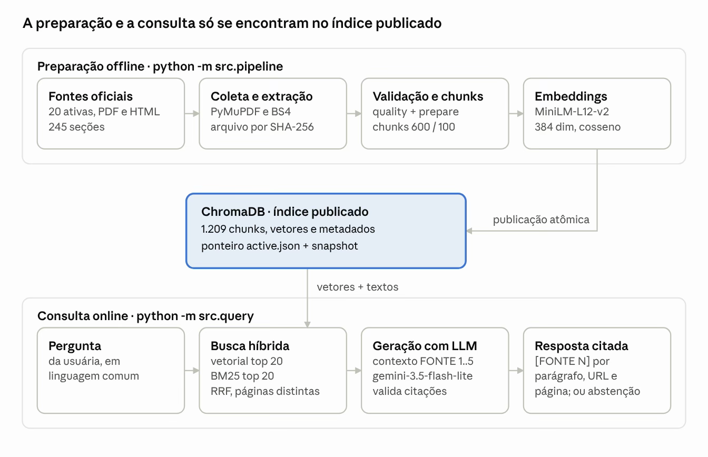
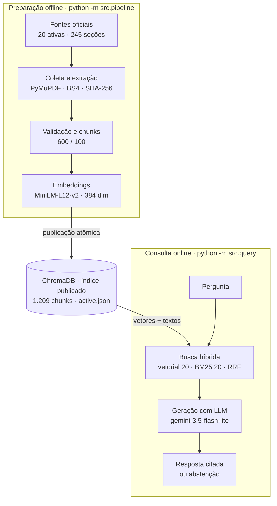

# Arquitetura do RAG

{ loading=lazy }

*Figura 1 – Arquitetura do RAG Artemis: preparação offline e consulta online.*

Em cima, a base é construída e publicada de uma vez; embaixo, cada pergunta busca no índice ativo e só recebe resposta com citação verificada. **Como as duas partes só se encontram no índice, reconstruir a base nunca interrompe as consultas.**

## Em texto

=== "Preparação offline"

    Comando: `python -m src.pipeline`

    | Etapa | Descrição |
    |---|---|
    | Fontes oficiais | 20 ativas, PDF e HTML, 245 seções |
    | Coleta e extração | PyMuPDF e BS4, arquivo por SHA-256 |
    | Validação e chunks | `quality` + `prepare`, chunks 600 / 100 |
    | Embeddings | MiniLM-L12-v2, 384 dim, cosseno |

=== "Índice publicado"

    **ChromaDB · índice publicado**: 1.209 chunks, vetores e metadados; ponteiro `active.json` + snapshot. A **publicação atômica** liga a preparação à consulta.

=== "Consulta online"

    Comando: `python -m src.query`

    | Etapa | Descrição |
    |---|---|
    | Pergunta | da usuária, em linguagem comum |
    | Busca híbrida | vetorial top 20, BM25 top 20, RRF, páginas distintas |
    | Geração com LLM | contexto FONTE 1..5, `gemini-3.5-flash-lite`, valida citações |
    | Resposta citada | `[FONTE N]` por parágrafo, URL e página; ou abstenção |

## Fluxo

Detalhes de cada bloco: [Pipeline](../rag/pipeline.md) · [Chunking](../rag/chunking.md) · [Embeddings](../rag/embeddings.md) · [Consulta](../rag/consulta.md).
