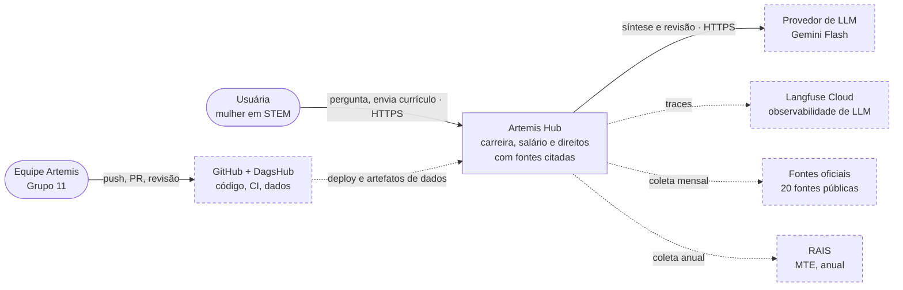
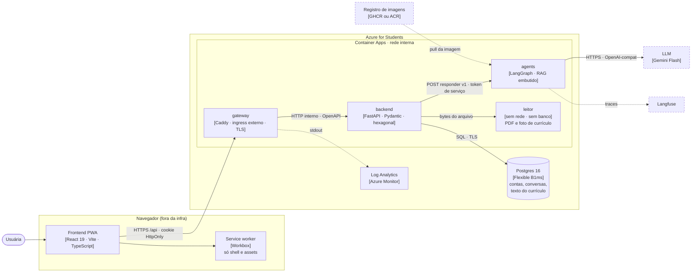
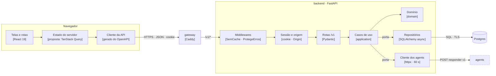
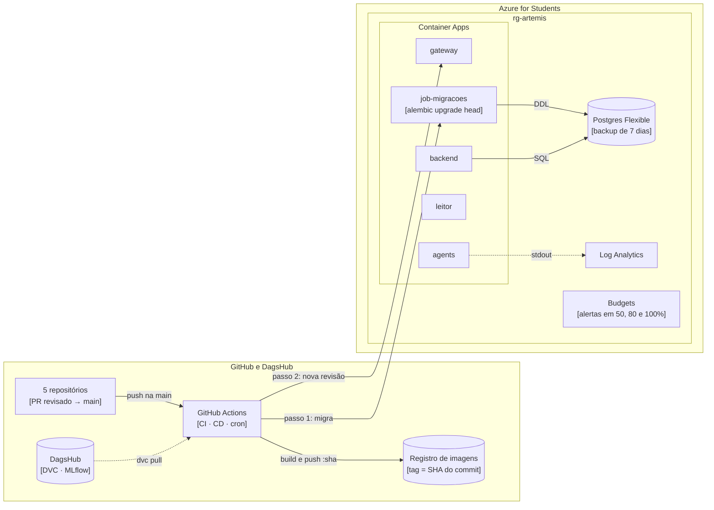
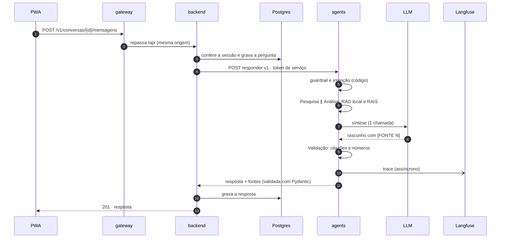

# Visões C4 da arquitetura

Esta página descreve a arquitetura do Artemis no [modelo C4](https://c4model.com): primeiro o contexto, depois os containers, os componentes do frontend e do backend, a implantação e a sequência de uma pergunta. O plano de dados (DAGs, DVC, MLflow), a stack e o custo estão em [Implantação e pipelines de dados](implantacao.md).

!!! info "Planejado e existente"
    O backend, os agents e o RAG já existem. O frontend está em construção. A implantação no Azure, o leitor de currículo e as DAGs são propostas do [ADR-012](../adr/012-implantacao-e-pipelines-de-dados.md), ainda **não implantadas**. A versão interativa, em que cada bloco mostra responsabilidades, decisões e lacunas, está [nesta página](https://claude.ai/artifact/HUeEJjiyqYsEZNYqVjAPUy).

**Como ler os diagramas:**
- Retângulos são containers ou componentes; cilindros são armazenamento.
- Blocos tracejados são externos.
- Seta contínua é chamada síncrona; seta tracejada é assíncrona ou batch.
- Cada caixa traz o nome e, entre colchetes, a tecnologia.

## 1. Contexto do sistema

Quem usa o Artemis e de quais sistemas externos ele depende.

## 2. Containers

As peças que rodam, como se falam e onde ficam as fronteiras de confiança. **Só o gateway é exposto à internet**, e **dados pessoais ficam só no Postgres**.

| Container | Responsabilidade | Decisões |
|---|---|---|
| Frontend PWA | Cadastro com consentimento, login, conversas e Minha conta. Cliente tipado gerado do `openapi.json`. O service worker nunca guarda respostas de `/v1` | ADR-001, ADR-010, ADR-012 |
| gateway | Entrega o build do frontend e repassa `/api`. Mantém a mesma origem que o cookie `SameSite=Strict` exige | ADR-001, ADR-012 |
| backend | Contas, sessão, conversas e chamada aos agents. Recebe o currículo, manda os bytes ao leitor, aplica a máscara obrigatória e guarda só o texto | ADR-001, ADR-010 |
| agents | Orquestrador, Pesquisa, Análise e Validação. Índice do RAG e tabelas da RAIS somente leitura, dentro da imagem | ADR-002, ADR-011, ADR-012 |
| leitor | Lê o currículo em PDF ou foto na CPU, com modelo aberto. Isolado, porque é quem abre arquivos de terceiros | [desenho do currículo](https://github.com/ArtemisHubApp/artemishub_backend/blob/claude/pensive-franklin-ggl64a/docs/superpowers/specs/2026-11-26-curriculo-design.md) |
| Postgres | Único lugar com dados pessoais. O arquivo do currículo nunca chega aqui, só o texto conferido e mascarado | ADR-001 |

## 3. Frontend ↔ Backend (componentes)

O frontend e a API ficam na mesma origem, por isso **não há CORS**: o cookie `artemis_sessao` (`HttpOnly`, `SameSite=Strict`, `Secure`) vai sozinho, e o backend confere o cabeçalho `Origin` em toda escrita, como proteção contra CSRF.

| Método | Rota | Tela | Acesso | Observação |
|---|---|---|---|---|
| `POST` | `/v1/auth/cadastro` | Cadastro | pública; recusa `Origin` de outro site | grava o cookie de sessão |
| `GET` | `/v1/consentimento` | Cadastro | pública | texto do consentimento (provisório) |
| `POST` | `/v1/auth/login` | Login | pública; recusa `Origin` de outro site | limite de tentativas na backend#17 |
| `POST` | `/v1/auth/sair` | Menu | cookie + `Origin` | apaga o cookie |
| `GET` · `PATCH` · `DELETE` | `/v1/conta` | Minha conta | cookie (+ `Origin` na escrita) | o `DELETE` apaga conta e conversas |
| `GET` · `POST` · `DELETE` | `/v1/conversas` | Lista de conversas | cookie (+ `Origin` na escrita) | paginação por cursor |
| `GET` · `DELETE` | `/v1/conversas/{id}` | Conversa | cookie (+ `Origin` no `DELETE`) | só a dona vê (RNF-06) |
| `POST` | `/v1/conversas/{id}/mensagens` | Conversa | cookie + `Origin` | chama os agents; até 60 s |
| `POST` | `/v1/curriculo/leitura` | Meu currículo | cookie + `Origin` | **planejada**: devolve o texto para conferir, nada é gravado |
| `PUT` · `GET` · `DELETE` | `/v1/curriculo` | Meu currículo | cookie (+ `Origin` na escrita) | **planejada**: guarda só o texto conferido e mascarado |

Toda resposta de `/v1` sai com `Cache-Control: no-store`. O contrato completo está no [`openapi.json`](https://github.com/ArtemisHubApp/artemishub_backend/blob/main/contratos/openapi.json) do backend.

## 4. Implantação

Onde cada container roda e como uma versão chega à produção. Staging é uma revisão do Container Apps com 0% do tráfego, no mesmo ambiente, para não dobrar o custo.

**Ordem do deploy:**
1. Build e push da imagem com a tag do SHA.
2. Job de migração (`alembic upgrade head`), no padrão expandir e depois contrair.
3. Nova revisão.
4. Troca de tráfego.

Rollback é reativar a revisão anterior. O checklist completo está na [backend#6](https://github.com/ArtemisHubApp/artemishub_backend/issues/6).

## 5. Uma pergunta, de ponta a ponta

**Orçamento de latência para a meta de 10 s do PDR.** São números propostos, ainda não medidos; a medição é a [backend#27](https://github.com/ArtemisHubApp/artemishub_backend/issues/27).

| Etapa | Orçamento |
|---|--:|
| Rede, gateway e backend | 0,2 s |
| Postgres (2 escritas) | 0,1 s |
| Guardrail e intenção | 0,05 s |
| Recuperação (MiniLM + BM25) | 0,3 s |
| Consulta à RAIS | 0,05 s |
| LLM: síntese | 5 s |
| Validação | 0,1 s |
| Folga: 2ª chamada se a Validação reprovar | 4,2 s |
| **Total** | **10 s** |

Hoje o backend espera até 60 s pelos agents, sem streaming. O cold start dos agents (de 20 a 40 s) sozinho estoura a meta, por isso o ADR-012 prevê uma réplica mínima nas janelas de uso.

## 6. Contratos de dados

Cada fronteira entre repositórios tem um contrato escrito, que deve ser validado dos dois lados.

| Fronteira | Contrato | Valida hoje | Falta |
|---|---|---|---|
| frontend → backend | `contratos/openapi.json`, gerado dos modelos Pydantic do FastAPI | backend | gerar o cliente TypeScript desse arquivo e falhar o CI do frontend quando ele mudar |
| backend → agents | `contratos/responder.v1.schema.json` (JSON Schema, rascunho) | só o backend | modelos Pydantic nos agents a partir do mesmo schema e teste de contrato nos dois CIs ([agents#36](https://github.com/ArtemisHubApp/artemishub_agents/issues/36)) |
| backend → leitor | `contratos/leitor.v1.schema.json` (planejado) | — | parte do plano do currículo (backend#3, agents#14) |
| `dag_rais` → agents | tabelas parquet da RAIS | ninguém | schema validado antes do `dvc push` e no startup ([agents#64](https://github.com/ArtemisHubApp/artemishub_agents/issues/64)) |
| `dag_rag` → agents | índice do ChromaDB + manifesto (modelo, revisão, hash) | agents | schema do manifesto, versionado com o índice |
| agents → LLM | prompts versionados no Langfuse; saída em texto com `[FONTE N]` | Validação | saída estruturada para a Validação conferir campos |

## 7. Lacunas conhecidas

Levantadas na revisão de arquitetura do ADR-012, lendo o código e os ADRs. **Alta**: bloqueia o deploy ou expõe dados pessoais. **Média**: falha em produção sem aviso. **Baixa**: qualidade ou acabamento.

| Severidade | Tema | Lacuna | Issue |
|---|---|---|---|
| alta | Decisão | O ADR-001 diz que os agents não têm banco; o ADR-002 põe o checkpointer do RF-09 no Postgres | [docs#50](https://github.com/ArtemisHubApp/artemishub_docs/issues/50) |
| alta | LGPD | Retenção, Langfuse que guarda os traces depois da exclusão, Gemini no tier gratuito, menores de idade | [docs#51](https://github.com/ArtemisHubApp/artemishub_docs/issues/51) |
| alta | Desempenho | Timeout de 60 s e sem streaming, contra a meta de 10 s | [backend#27](https://github.com/ArtemisHubApp/artemishub_backend/issues/27) |
| alta | Contratos | Os agents ainda não têm servidor HTTP; o contrato está em rascunho | [agents#36](https://github.com/ArtemisHubApp/artemishub_agents/issues/36) |
| alta | Entrega | Migrações, rollback e restauração ainda não fazem parte do deploy | [backend#6](https://github.com/ArtemisHubApp/artemishub_backend/issues/6) |
| média | Contratos | Tabelas da RAIS publicadas sem schema | [agents#64](https://github.com/ArtemisHubApp/artemishub_agents/issues/64) |
| média | Observabilidade | Sem id de correlação entre backend, agents e Langfuse | [backend#28](https://github.com/ArtemisHubApp/artemishub_backend/issues/28) |
| média | Abuso e custo | Sem cota de perguntas por usuária | [backend#29](https://github.com/ArtemisHubApp/artemishub_backend/issues/29) |
| média | Segurança | Prompt injection também pelos trechos do RAG e pelo currículo | [agents#21](https://github.com/ArtemisHubApp/artemishub_agents/issues/21) |
| média | Resiliência | Sem provedor de LLM reserva | [agents#60](https://github.com/ArtemisHubApp/artemishub_agents/issues/60) |
| baixa | Segurança | Cabeçalhos de segurança na API | [backend#30](https://github.com/ArtemisHubApp/artemishub_backend/issues/30) |
| baixa | Compatibilidade | Sem matriz de navegadores e dispositivos (RNF-05) | [docs#52](https://github.com/ArtemisHubApp/artemishub_docs/issues/52) |

O upload de currículo, que era lacuna alta, foi resolvido pelo [desenho do currículo](https://github.com/ArtemisHubApp/artemishub_backend/blob/claude/pensive-franklin-ggl64a/docs/superpowers/specs/2026-11-26-curriculo-design.md): o arquivo nunca é gravado, só o texto conferido e mascarado.
