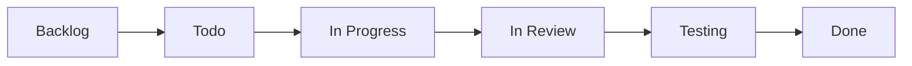

# Como trabalhamos (kanban)

Todas as issues, de **qualquer repositório**, entram no mesmo [GitHub Project](https://github.com/orgs/ArtemisHubApp/projects), com as colunas:

**Backlog → Todo → In Progress → In Review → Testing → Done**

<ol class="art-steps" markdown>
<li markdown>
Crie a issue no repositório correspondente (ou no `artemishub_docs`, se for documentação ou tarefa geral).
</li>
<li markdown>
Marque a **Semana** do roadmap a que ela pertence.
</li>
<li markdown>
Ao começar, mova o card para **In Progress** e atribua a issue a você.
</li>
<li markdown>
Abra o PR com `Closes #<número>` na descrição: o card vai para **In Review** automaticamente.
</li>
<li markdown>
Com o PR aprovado o card vai para **Testing**; após o merge, para **Done**.
</li>
</ol>

## Como contribuir com esta documentação

Para contribuir, edite o arquivo correspondente na pasta `docs/` do repositório no GitHub e envie as alterações por *pull request*. As páginas incluem um bloco de **Rastreabilidade** no fim, com o documento de origem e o histórico de commits.
