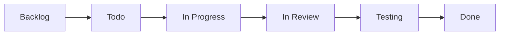

# Como trabalhamos (kanban)

Todas as issues, de **qualquer repositório**, entram no mesmo [GitHub Project](https://github.com/orgs/ArtemisHubApp/projects), com as colunas:

**Backlog → Todo → In Progress → In Review → Testing → Done**

<ol class="art-steps" markdown>
<li markdown>
Crie a issue no repositório correspondente (ou no `artemishub_docs`, se for documentação ou tarefa geral).
</li>
<li markdown>
Marque a **Semana** do roadmap a que ela pertence.
</li>
<li markdown>
Ao começar, mova o card para **In Progress** e atribua a issue a você.
</li>
<li markdown>
Abra o PR com `Closes #<número>` na descrição: o card vai para **In Review** automaticamente.
</li>
<li markdown>
Com o PR aprovado o card vai para **Testing**; após o merge, para **Done**.
</li>
</ol>

!!! tip "Branches e rastreabilidade"
    Toda tarefa tem uma issue associada. O trabalho começa numa worktree com branch criada a partir da `staging` (`python scripts/worktree.py new <repo> <tipo>/<nº>-<slug>`, no orquestrador). O PR vai para a `staging` com `Closes #<nº>` e as docs atualizadas. A `main` só recebe o PR de release. Detalhes nos [ADR-008](../adr/008-staging-e-worktrees.md) e [ADR-009](../adr/009-higiene-github.md).

## Formulários e labels

Em **New issue** aparecem 4 formulários: feature, bug, chore e docs. A issue em branco está desligada. Todo formulário pede **Semana**, **Critérios de aceite** e **Repositório afetado**, e já coloca a label `tipo: …` sozinho.

Quem faz a triagem acrescenta `semana-N` e `prioridade: alta|média|baixa` e preenche o campo **Semana** do Project.

Os formulários, o template de PR e as labels ficam no repo [`ArtemisHubApp/.github`](https://github.com/ArtemisHubApp/.github) e valem para todos os repos da org.

## Como contribuir com esta documentação

Para contribuir, edite o arquivo correspondente na pasta `docs/` do repositório no GitHub e envie as alterações por *pull request*. As páginas incluem um bloco de **Rastreabilidade** no fim, com o documento de origem e o histórico de commits.
