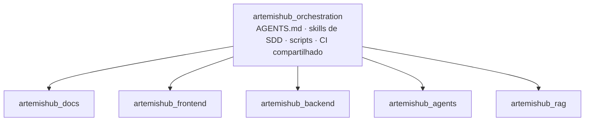

# Orquestrador de SDD

O Artemis é construído com agentes de IA (Codex, Gemini, Claude e GPT) seguindo **SDD**, *spec-driven development*: primeiro entendemos e escrevemos o que vai ser feito, depois planejamos, testamos e implementamos. O repositório **[artemishub_orchestration](https://github.com/ArtemisHubApp/artemishub_orchestration)** junta tudo isso num lugar só.



## O que ele tem

- **Os cinco repositórios como submódulos.** Um clone traz tudo, e o código continua em cada repo ([ADR-003](../adr/003-repo-orquestrador.md)).
- **`AGENTS.md`:** a fonte única de regras para todos os agentes. O `CLAUDE.md` e o `GEMINI.md` só importam esse arquivo ([ADR-004](../adr/004-agents-md-fonte-unica.md)).
- **Skills de SDD:** o Superpowers mais a `artemis-sdd`, com as regras do projeto. Skills ficam só aqui ([ADR-005](../adr/005-sdd-superpowers.md)).
- **CI compartilhado para os repos Python:** uv com `uv.lock`, ruff, testes, título de PR e gitleaks ([ADR-006](../adr/006-uv-e-ci-reutilizavel.md)).
- **Ambiente de desenvolvimento com Docker** para rodar o RAG sem instalar Python ([ADR-007](../adr/007-compose-de-desenvolvimento.md)).
- **Scripts que funcionam no Windows, macOS e Linux:** setup, sync, status, worktrees e faxina de branches.

## Começar (uma vez)

```bash title="Primeiro uso"
git clone --recurse-submodules https://github.com/ArtemisHubApp/artemishub_orchestration.git
cd artemishub_orchestration
python scripts/setup.py
```

No macOS, use `python3` se `python` não existir. Quem usa o ChatGPT no navegador anexa o `AGENTS.md` na conversa.

## Dia a dia

<ol class="art-steps" markdown>
<li markdown>
**Issue primeiro.** Toda tarefa tem uma issue associada no [kanban](kanban.md).
</li>
<li markdown>
**Worktree a partir da `staging`:** `python scripts/worktree.py new <repo> <tipo>/<nº>-<slug>`, por exemplo `feat/20-ocr-diretrizes` ([ADR-008](../adr/008-staging-e-worktrees.md)).
</li>
<li markdown>
**Abra o agente na pasta do orquestrador** e dê a ele acesso à pasta da worktree. O comando de cada ferramenta está em "Como abrir o agente numa tarefa", no `AGENTS.md`.
</li>
<li markdown>
**SDD na medida da tarefa:** uma edição trivial vai direto; o resto passa por spec, plano, testes e revisão.
</li>
<li markdown>
**PR para a `staging`** do repo da tarefa (nunca para o orquestrador), com `Closes #<nº>`, título no padrão Conventional Commits e **docs sempre atualizadas** ([ADR-009](../adr/009-higiene-github.md)).
</li>
<li markdown>
**Código limpo e camadas** (domínio, casos de uso e adaptadores), conferidos pelo CI ([ADR-010](../adr/010-codigo-limpo-hexagonal.md)).
</li>
</ol>

Para atualizar o orquestrador e os cinco repos: `python scripts/sync.py`. O comando nunca apaga mudanças locais: se um repo tem trabalho em andamento, ele é pulado com um aviso.
