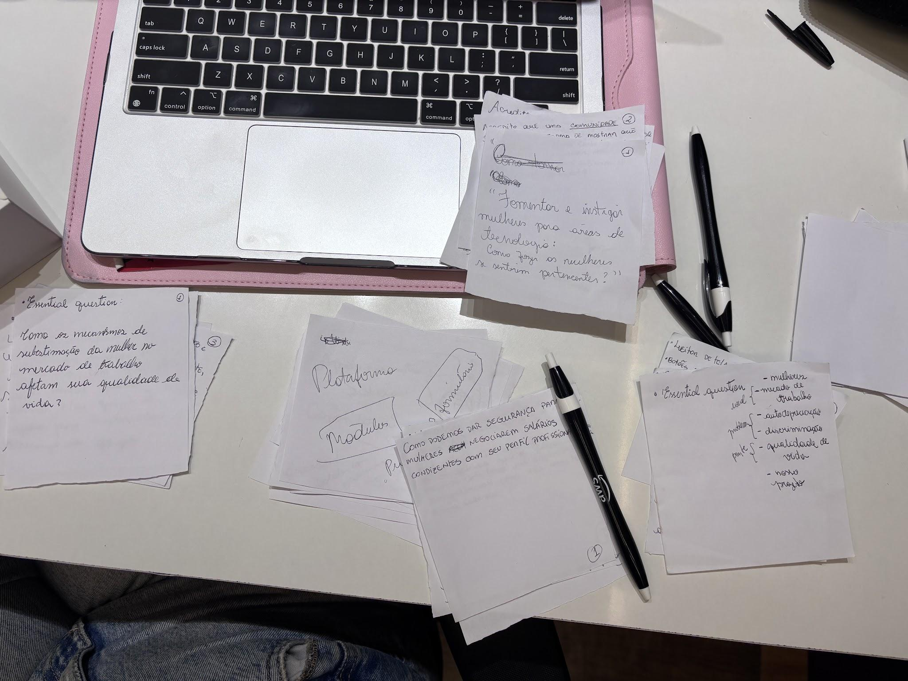
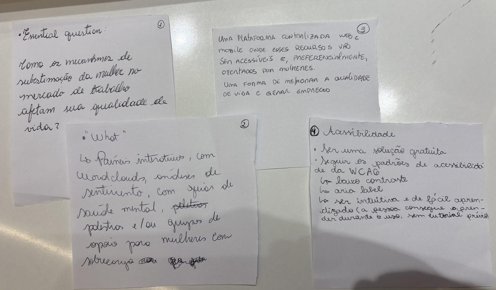
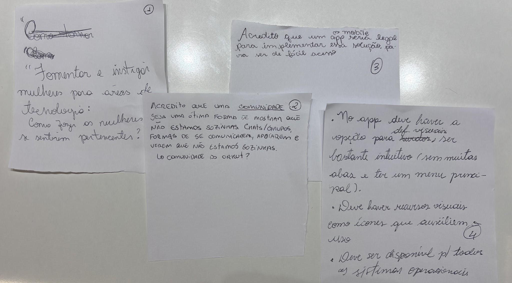
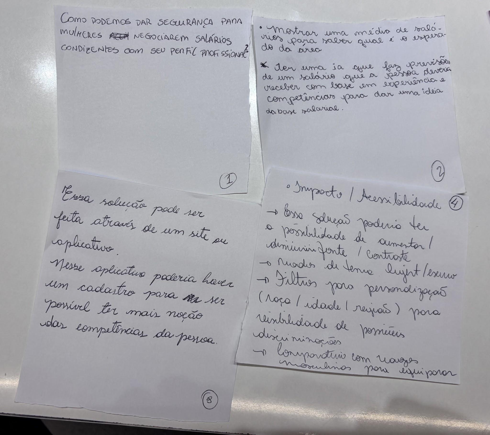
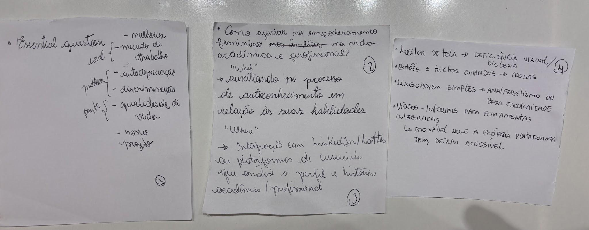
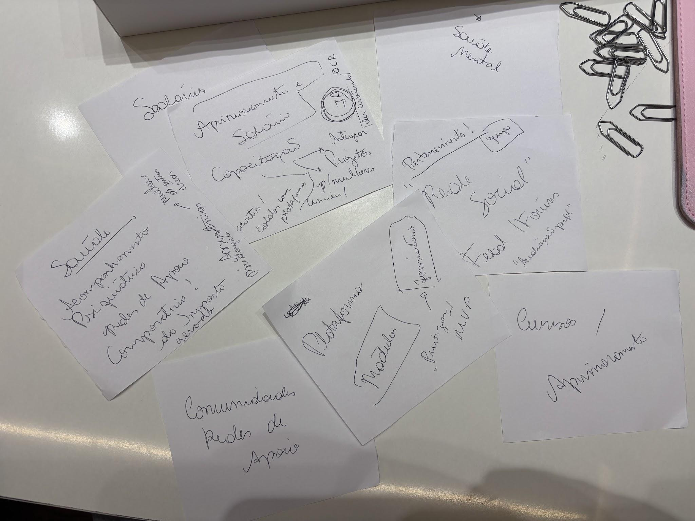

# Brainstorming: Round Robin

## Visão geral da metodologia

A dinâmica usou a técnica de **Round Robin Brainstorming** adaptada para o desenvolvimento de produtos de Inteligência Artificial. O Round Robin é um método de ideação colaborativa em que os participantes constroem ideias de forma sequencial e rotativa.

Na prática, o processo combinou princípios de facilitação ágil e *brainwriting* cíclico: cada participante começa um registro próprio e, a cada rodada cronometrada, o material é passado para a colega à esquerda (sentido anti-horário). Assim, cada integrante adiciona uma camada nova à ideia da anterior (passando por problema, solução de IA, ecossistema e acessibilidade), garantindo que o projeto final seja o resultado síncrono e integrado da co-criação coletiva, sem vieses de hierarquia ou dominância de voz.

!!! quote "Por que essa dinâmica"
    Foi escolhida para eliminar os vieses de IAs no processo de decisão e instigar a criatividade e o pensamento humano das integrantes sem interferência externa, resultando em um canal de contribuição orgânico.

{ loading=lazy }

## Estrutura das rodadas

Cada rodada durou **5 minutos**.

<ol class="art-steps" markdown>
<li markdown>
**Rodada 1: A Essência (*The "Why"*)**

*Objetivo:* definir a grande pergunta norteadora (*Essential Question*) do projeto de IA, alinhando o tema central e o público-alvo.

*Dinâmica:* cada participante escreve em um papel sua visão da pergunta central que o produto de IA deve responder (ex.: "Como podemos ajudar [público-alvo] a [resolver dor] usando IA?"). Ao término do tempo, o papel é passado adiante.
</li>
<li markdown>
**Rodada 2: A Solução de IA (*The "What"*)**

*Objetivo:* dar forma técnica e prática à pergunta recebida, definindo a ideia de solução baseada em Inteligência Artificial.

*Dinâmica:* a participante lê a pergunta que chegou à sua mão e complementa com uma solução técnica (ex.: "Um modelo preditivo de Machine Learning cruzando dados de [X] com [Y]"). O papel continua rodando.
</li>
<li markdown>
**Rodada 3: O Ecossistema e Onde Vai Viver (*The "Where"*)**

*Objetivo:* definir o canal, o formato de entrega e como o usuário interage com o produto no dia a dia.

*Dinâmica:* a partir do histórico acumulado (pergunta + solução), decide-se onde o produto vai rodar (ex.: "Chatbot integrado ao WhatsApp", "Dashboard web responsivo", "Plugin de navegador"). O papel roda pela última vez.
</li>
<li markdown>
**Rodada 4: Acessibilidade e Inclusão (*The "How / Impact"*)**

*Objetivo:* adicionar camadas de usabilidade, ética, transparência e eliminação de barreiras para o público-alvo.

*Dinâmica:* a jornada completa é revisada para garantir um design inclusivo (ex.: suporte a áudio para baixa alfabetização digital, contraste alto, explicabilidade do modelo, consumo leve de dados). O papel retorna à dona original.
</li>
<li markdown>
**Fechamento e *Gran Finale*: a consolidação das ideias**

*Objetivo:* consolidar e discutir ideias, gerar insights, deduplicar.

*Dinâmica:* após o ciclo completo do Round Robin, os papéis retornam às donas originais para uma rodada de leitura dinâmica, identificação de padrões e unificação dos melhores insights.
</li>
</ol>

## Resultados: os quatro projetos gerados

=== "Ideia 1"

    **Problema / pergunta central**
    :   Como os mecanismos de subestimação da mulher no mercado de trabalho afetam sua qualidade de vida?

    **Solução tecnológica**
    :   Painéis interativos, com *word clouds*, análises de sentimento, guias sobre saúde mental, palestras e/ou grupos de apoio para mulheres com sobrecarga.

    **Canal / onde vive**
    :   Uma plataforma centralizada *web* e *mobile* onde esses recursos vão ser acessíveis e, preferencialmente, ofertados por mulheres. Uma forma de melhorar a qualidade de vida e gerar emprego.

    **Diferencial e inclusão**
    :   - Ser uma solução gratuita
        - Seguir os padrões de acessibilidade da WCAG: baixo contraste, *aria label*, ser intuitiva e de fácil aprendizado (a pessoa consegue aprender durante o uso, sem tutorial prévio)

    { loading=lazy }

=== "Ideia 2"

    **Problema / pergunta central**
    :   Fomentar e instigar mulheres para áreas de tecnologia: como fazer as mulheres se sentirem pertencentes?

    **Solução tecnológica**
    :   Uma comunidade como uma forma de mostrar que as mulheres não estão sozinhas. Chats, grupos, formas de se comunicarem, apoiarem e verem que não estão sozinhas (algo parecido com o que eram as comunidades do Orkut).

    **Canal / onde vive**
    :   Um app mobile para ser de fácil acesso.

    **Diferencial e inclusão**
    :   - No app deve haver a opção para deficientes visuais, ser bastante intuitivo (sem muitas abas e ter um menu principal).
        - Deve haver recursos visuais como ícones que auxiliam o uso.
        - Deve estar disponível para todos os sistemas operacionais.

    { loading=lazy }

=== "Ideia 3"

    **Problema / pergunta central**
    :   Como podemos dar segurança para mulheres negociarem salários condizentes com seu perfil profissional?

    **Solução tecnológica**
    :   - Mostrar uma média de salários para saber qual é o esperado da área.
        - Ter uma IA que faz previsões de um salário que a pessoa deve receber com base em experiência e competências para dar uma ideia de base salarial.

    **Canal / onde vive**
    :   - Essa solução pode ser feita através de um site ou aplicativo.
        - Nesse aplicativo poderia haver um cadastro para ser possível ter mais noção das competências da pessoa.

    **Diferencial e inclusão**
    :   - Possibilidade de aumentar/diminuir fonte e contraste
        - Modos de tema light/escuro
        - Filtros para personalização (raça / idade / região) para visibilidade de possíveis discriminações
        - Comparativo com salários masculinos para equiparar

    { loading=lazy }

=== "Ideia 4"

    **Problema / pergunta central**
    :   Como ajudar no empoderamento feminino na vida acadêmica e profissional?

        - Local: mulheres no mercado de trabalho
        - Problema: autodepreciação, discriminação
        - Ponte: qualidade de vida

    **Solução tecnológica**
    :   Auxiliando no processo de autoconhecimento em relação às suas habilidades.

    **Canal / onde vive**
    :   Integração com LinkedIn/Lattes ou plataformas de currículo que analise o perfil e histórico acadêmico / profissional.

    **Diferencial e inclusão**
    :   - Leitor de tela → deficiência visual, dislexia
        - Botões e textos grandes → idosas
        - Linguagem simples → analfabetismo ou baixa escolaridade
        - Vídeo-tutoriais para ferramentas integradas → provável que a própria plataforma deixa acessível

    { loading=lazy }

## Consolidação das ideias

Os temas principais abordados nas ideias foram **saúde mental**, **salários**, **cursos / aprimoramentos / capacitação** e **comunidades / redes de apoio**. Eles poderiam ser quebrados nas seguintes soluções:

=== "Saúde mental"

    - Acompanhamento psiquiátrico antes e após a utilização da ferramenta para geração de comparativo do impacto gerado pela solução
    - Redes de apoio
    - Aba com assistência psicológica com profissionais mulheres, de forma a apoiar mulheres de outras áreas

=== "Aprimoramento + salários"

    - Plataforma que integra projetos afirmativos para mulheres de universidades, etc.
    - Descontos / colabs com plataformas
    - O motor de IA *multiagents* viria daqui, com a recomendação personalizada (ex.: OCR para ler currículos, etc.)

=== "Pertencimento"

    - Uma rede social com feed, fóruns, avaliação de perfil

{ loading=lazy }

## A solução final

Isso levou à solução final: **uma plataforma com módulos que unem os grandes temas elencados**. A priorização de *features* para o MVP será fortalecida com os resultados do questionário / pesquisa qualitativa.

A solução final convergida combina IA (sistemas multiagentes) para apoiar em três frentes principais:

- :material-briefcase-check-outline: **Reconhecimento profissional e equidade salarial**

    Análise de perfil/currículo e inteligência de salários.

- :material-school-outline: **Capacitação e desenvolvimento**

    Recomendações personalizadas.

- :material-heart-multiple-outline: **Pertencimento e saúde mental**

    Redes de apoio e assistência.

