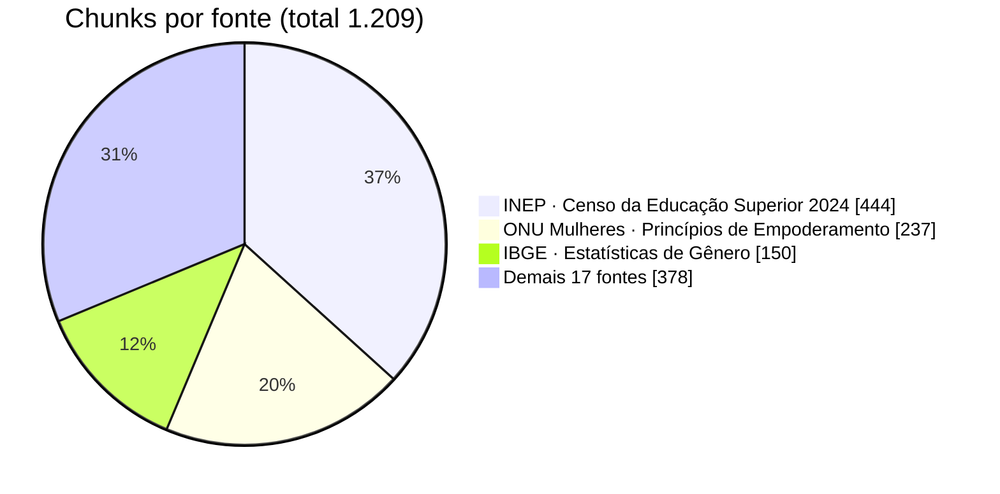

# Fontes

A base tem **20 fontes ativas**, que geram **245 seções** (uma por página de PDF ou por página HTML) e **1.209 chunks**. Todas são de órgãos públicos ou instituições reconhecidas, e cada uma tem no manifesto um marcador de texto que confirma que o documento baixado é o correto.

## Critérios de curadoria

- :material-shield-check-outline: **Só fontes oficiais ou institucionais**

    Quando o site principal falha, usam-se apenas alternativas oficiais brasileiras: as três normas do Planalto são coletadas da Câmara dos Deputados.

- :material-robot-off-outline: **Nenhum bloqueio contornado**

    Fontes que exigiriam burlar proteção anti-robô ficam de fora.

- :material-text-recognition: **Texto extraível**

    Uma página sem texto só é aceita se for declarada e conferida como vazia.

## As 20 fontes ativas

| # | Fonte | Órgão | Tipo | Tema | Chunks (% do índice) |
|--:|---|---|---|---|--:|
| 1 | Lei 14.611/2023 (Igualdade Salarial) | Presidência da República (via Câmara) | lei | igualdade salarial | 14 (1,2%) |
| 2 | CLT, art. 461 | Presidência da República (via Câmara) | lei | equiparação salarial | 7 (0,6%) |
| 3 | Decreto 11.795/2023 | Presidência da República (via Câmara) | decreto | igualdade salarial | 14 (1,2%) |
| 4 | Lei 9.029/1995 (práticas discriminatórias) | Presidência da República (via Câmara) | lei | discriminação no emprego | 8 (0,7%) |
| 5 | Lei 14.457/2022 (Emprega + Mulheres) | Presidência da República (via Câmara) | lei | mercado de trabalho | 8 (0,7%) |
| 6 | Portaria MTE nº 3.714/2023 | Ministério do Trabalho e Emprego | portaria | transparência salarial | 19 (1,6%) |
| 7 | Orientação Técnica SIT nº 11/2024 | Ministério do Trabalho e Emprego | orientação técnica | multa por discriminação | 4 (0,3%) |
| 8 | Cartilha Tira-Dúvidas da Lei da Igualdade Salarial | Ministério das Mulheres e MTE | cartilha | igualdade salarial | 36 (3,0%) |
| 9 | Guia para Negociação Coletiva da Lei de Igualdade Salarial | Ministério das Mulheres e MTE | guia | negociação | 89 (7,4%) |
| 10 | Diretrizes para os Planos de Ação | Ministério das Mulheres | guia | planos de ação | 26 (2,2%) |
| 11 | Plano Nacional de Igualdade Salarial e Laboral | Ministério das Mulheres | página oficial | política pública | 13 (1,1%) |
| 12 | Relatório de Transparência Salarial | Ministério das Mulheres | página oficial | transparência salarial | 4 (0,3%) |
| 13 | 6º Relatório de Transparência Salarial: envio de dados | Agência Gov / MTE | notícia oficial | transparência salarial | 4 (0,3%) |
| 14 | Dia Internacional das Mulheres e Meninas na Ciência (fev/2026) | Ministério das Mulheres | notícia oficial | STEM | 9 (0,7%) |
| 15 | Estatísticas de Gênero | IBGE | estudo estatístico | dados de gênero | 150 (12,4%) |
| 16 | Resumo Técnico do Censo da Educação Superior 2024 | INEP | estudo estatístico | ensino superior | 444 (36,7%) |
| 17 | Boletim Especial 8 de Março de 2026 | DIEESE | boletim | mercado de trabalho | 56 (4,6%) |
| 18 | Panorama da desigualdade de gênero (PNADC e SMT) | FGV IBRE | estudo | dados de gênero | 53 (4,4%) |
| 19 | Princípios de Empoderamento das Mulheres | ONU Mulheres e Pacto Global | guia | empoderamento | 237 (19,6%) |
| 20 | Programa Meninas Digitais | Sociedade Brasileira de Computação | página institucional | STEM | 14 (1,2%) |

Os links oficiais de cada fonte estão em [Referências](../sobre/referencias.md#base-de-conhecimento-rag).

### Distribuição desigual, busca não dominada

O volume é desigual porque os documentos têm tamanhos muito diferentes: **INEP, ONU Mulheres e IBGE somam 68,7% dos chunks**. A [avaliação](../avaliacao/index.md) mostrou que esse volume não domina a busca.

## Fontes desabilitadas

Três candidatas ficaram desabilitadas, com o motivo registrado no manifesto:

| Candidata | Motivo |
|---|---|
| Relatório Final do GTI | arquivo removido do portal (erro 404) |
| Matéria do IBGE Educa | bloqueio anti-robô e duplicata da fonte 15 |
| Cartilha do Plano Nacional | página de imagem cujo conteúdo não pôde ser confirmado |
