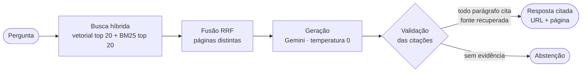

# Base de conhecimento (RAG)

O RAG Artemis responde perguntas sobre **igualdade salarial, direitos trabalhistas e carreira de mulheres em STEM** a partir de **20 documentos-fonte oficiais**, e toda resposta exibida cita o trecho e a página de onde veio.

A busca é **híbrida** (vetorial e BM25) sobre **1.209 chunks** indexados no ChromaDB, e a geração usa o Gemini com **validação automática das citações**. O código, os dados de avaliação e a documentação estão no repositório [ArtemisHubApp/artemishub_rag](https://github.com/ArtemisHubApp/artemishub_rag).

<strong>20</strong>fontes oficiais ativas

<strong>245</strong>seções (uma por página de PDF ou HTML)

<strong>1.209</strong>chunks indexados

<strong>93,75%</strong>Recall@5, perguntas originais (gabarito v2)

<strong>84,38%</strong>Recall@5, holdout (gabarito v2)

## Da pergunta à resposta citada

Sem evidência, o sistema responde: *"Não encontrei evidência suficiente na base para responder."*

## Artefatos relacionados ao RAG

A tabela abaixo reúne os artefatos do RAG, com links para suas páginas nesta documentação e os arquivos correspondentes no repositório.

| Artefato | Página | No repositório |
|---|---|---|
| Base de conhecimento e fontes documentais | [Fontes](fontes.md) | `config/sources.json`, `docs/base_de_conhecimento.md` |
| Pipeline de ingestão de dados | [Pipeline de ingestão](pipeline.md) | `src/pipeline.py`, `src/ingest.py`, `src/quality.py` |
| Estratégia de chunking | [Chunking](chunking.md) | `src/prepare.py` |
| Estratégia de embeddings | [Embeddings e banco vetorial](embeddings.md) | `src/index.py` |
| Banco vetorial | [Embeddings e banco vetorial](embeddings.md) | `src/index.py`, `.chroma/` (gerado) |
| Consulta com recuperação | [Consulta e resposta](consulta.md) | `src/query.py`, `src/lexical.py` |
| Resposta fundamentada e evidência das fontes | [Consulta e resposta](consulta.md) · [Demonstração](demonstracao.md) | `src/query.py`, `src/demo.py`, `reports/demo_rag.md` (anexo) |
| Diagrama de arquitetura | [Arquitetura do RAG](../arquitetura/rag.md) | `docs/architecture.md` |
| Avaliação da recuperação | [Avaliação](../avaliacao/index.md) | `src/evaluate.py`, `evaluation/`, `docs/validation_report.md` |
