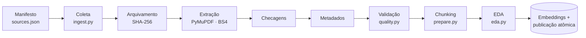

# Pipeline de ingestão

Um comando (`python -m src.pipeline`) leva as fontes oficiais até um índice publicado, e **só publica se todas as etapas passarem**. Se uma fonte falhar, nada é publicado e o índice anterior continua no ar.

## As 10 etapas

<ol class="art-steps" markdown>
<li markdown>
**Manifesto** (`config/sources.json`): cada fonte tem id, título, órgão, URL, formato, marcadores de texto esperados e alternativas oficiais com justificativa.
</li>
<li markdown>
**Coleta** (`src/ingest.py`): download com tempo limite, novas tentativas e limite de tamanho; se o Planalto não responde, usa a alternativa da Câmara e registra isso nos metadados.
</li>
<li markdown>
**Arquivamento:** cada arquivo baixado é guardado com o nome igual ao seu hash SHA-256, o que prova qual versão foi usada.
</li>
<li markdown>
**Extração:** PDF com PyMuPDF, uma seção por página; HTML com BeautifulSoup, sem menus, scripts nem texto revogado.
</li>
<li markdown>
**Checagens:** a fonte é recusada se vier sem os marcadores esperados, curta demais ou com página vazia não declarada.
</li>
<li markdown>
**Metadados:** cada seção recebe fonte, órgão, URL usada, página, data de coleta e hash do conteúdo.
</li>
<li markdown>
**Validação** (`src/quality.py`): campos obrigatórios, URLs, hashes e localizadores únicos.
</li>
<li markdown>
**Chunking** (`src/prepare.py`) e validação dos chunks: todo chunk existe literalmente no documento de origem. Veja [Chunking](chunking.md).
</li>
<li markdown>
**EDA** (`src/eda.py`): perfil das fontes e alertas de qualidade em `reports/eda.json`.
</li>
<li markdown>
**Embeddings e publicação atômica** (`src/index.py`): grava uma coleção nova no ChromaDB e só então troca o ponteiro do índice ativo; as coleções antigas ficam preservadas. Veja [Embeddings e banco vetorial](embeddings.md).
</li>
</ol>

!!! success "Por que isso importa"
    Como a publicação é atômica, **reconstruir a base nunca interrompe as consultas**: a consulta online só enxerga o índice ativo.
